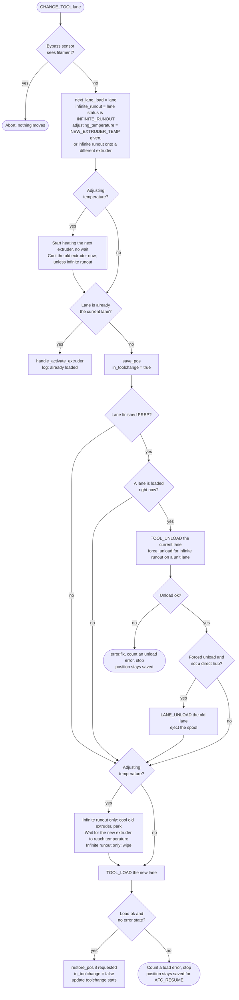

# `CHANGE_TOOL`

**Class:** `afc`  
**File:** `extras/AFC.py`

Performs a tool change: saves the position, unloads whatever is loaded, optionally heats and waits, loads the new lane, then restores the position.

## Flow

## Where it lives in code

| Step | Code |
| --- | --- |
| Method | `afc.CHANGE_TOOL` in `extras/AFC.py` |
| Bypass check | [`afc._check_bypass`](_check_bypass.md) |
| Heat and cool | [`afc._heat_next_extruder`](_heat_next_extruder.md), [`afc._cooldown_last_extruder`](_cooldown_last_extruder.md) |
| Wait for temperature | [`afc._wait_for_temp_within_tolerance`](_wait_for_temp_within_tolerance.md) |
| Already current lane | [`afcFunction.handle_activate_extruder`](../AFC_functions/handle_activate_extruder.md) |
| Position save and restore | [`afc.save_pos`](save_pos.md), [`afc.restore_pos`](restore_pos.md) |
| Unload and load | [`afc.TOOL_UNLOAD`](TOOL_UNLOAD.md), [`afc.TOOL_LOAD`](TOOL_LOAD.md) |
| Eject on forced unload | [`afc.LANE_UNLOAD`](LANE_UNLOAD.md) |
| Failure handling | [`afcError.fix`](../AFC_error/fix.md), [`afcError.AFC_error`](../AFC_error/AFC_error.md) |
| Park and wipe on infinite runout | `afc.park_cmd` and `afc.wipe_cmd`, run with `afc.run_script` |
| Stats | `afc.afc_stats` (`increase_unload_error_count`, `increase_load_error_count`, `average_toolchange_time`) and `AFCExtruder.estats` |

## Notes

- `next_lane_load` is set before anything moves. [`afc.TOOL_UNLOAD`](TOOL_UNLOAD.md) reads it to know where the change is heading, and it is cleared in a `finally` block.
- Asking for the lane that is already current skips all movement. It only re-syncs lane motors, buffers and LEDs.
- A lane that has not finished PREP (`AFCLane._afc_prep_done`) skips the unload and goes straight to the load.
- On either failure `in_toolchange` stays set, so a retry does not overwrite the saved position. [`afcError.cmd_AFC_RESUME`](../AFC_error/cmd_AFC_RESUME.md) clears it.
- Any unexpected exception is caught, logged with a traceback, and reported as one AFC error that pauses if a print is running.
- Infinite runout calls this with `restore_pos=False`, so the nozzle stays parked until the new lane has loaded.

## Related

- [`afc.cmd_CHANGE_TOOL`](cmd_CHANGE_TOOL.md)
- [`afc.TOOL_UNLOAD`](TOOL_UNLOAD.md)
- [`afc.TOOL_LOAD`](TOOL_LOAD.md)
- [`AFCLane._perform_infinite_runout`](../AFC_lane/_perform_infinite_runout.md)
