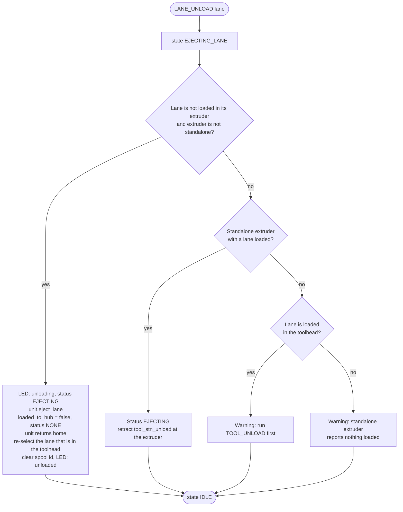

# `LANE_UNLOAD`

**Class:** `afc`  
**File:** `extras/AFC.py`

Ejects a lane's filament back out of the unit when the lane is not in use. Refusals are logged as warnings and nothing raises.

## Flow

## Where it lives in code

| Step | Code |
| --- | --- |
| Method | `afc.LANE_UNLOAD` in `extras/AFC.py` |
| LEDs | `afcUnit.lane_unloading` and `lane_unloaded` in `extras/AFC_unit.py` |
| Unit eject | `afcUnit.eject_lane`, implemented per unit. BoxTurtle: [`afcBoxTurtle.eject_lane`](../AFC_BoxTurtle/eject_lane.md) |
| Return home | `afcUnit.return_to_home` |
| Re-select toolhead lane | [`afcFunction.select_loaded_lane`](../AFC_functions/select_loaded_lane.md) |
| Spool | `AFCSpool.set_spoolID(lane, None)` in `extras/AFC_spool.py` |
| Standalone eject | `AFCExtruder.load_unload_sequence` in `extras/AFC_extruder.py` |
| State saved | `afc.save_vars` |

## Notes

- Refusals are logged as warnings so they reach the message queue and `AFC.message` in the status. The method never raises, so a refused eject and a completed one look identical from outside.
- The `EJECTING` status makes the prep sensor going low during the eject count as a normal removal. Without it, the runout and infinite spool logic would fire.
- There is a TODO in the code to check, for multi-toolhead printers, that the lane is not loaded in another toolhead before ejecting.

## Related

- [`afc.cmd_LANE_UNLOAD`](cmd_LANE_UNLOAD.md)
- [`afcBoxTurtle.eject_lane`](../AFC_BoxTurtle/eject_lane.md)
- [`afc.TOOL_UNLOAD`](TOOL_UNLOAD.md)
