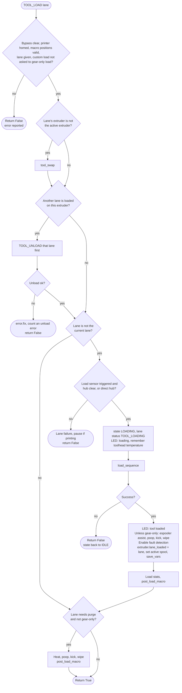

# `TOOL_LOAD`

**Class:** `afc`  
**File:** `extras/AFC.py`

Makes sure the right extruder is active and free, checks that the lane is ready, runs the load sequence, then purges.

## Flow

## Where it lives in code

| Step | Code |
| --- | --- |
| Method | `afc.TOOL_LOAD` in `extras/AFC.py` |
| Pre-checks | [`afc._check_bypass`](_check_bypass.md), `afcFunction.check_homed`, [`afc.verify_macro_positions`](verify_macro_positions.md), `afcFunction.check_absolute_mode` |
| Tool swap | `AFCLane.tool_swap` ([`AFCLane.tool_swap`](../AFC_lane/tool_swap.md)) |
| Stale lane unload | [`afc.TOOL_UNLOAD`](TOOL_UNLOAD.md) and [`afcError.fix`](../AFC_error/fix.md) |
| Readiness | `AFCLane.load_state`, `afc_hub.state`, `AFCLane.is_direct_hub` |
| Not ready | [`afcError.handle_lane_failure`](../AFC_error/handle_lane_failure.md) |
| LEDs | `afcUnit.lane_loading`, `lane_tool_loaded` in `extras/AFC_unit.py` |
| Temperature | [`afc.capture_toolhead_temp`](capture_toolhead_temp.md), [`afc.restore_toolhead_temp`](restore_toolhead_temp.md), [`afc._check_extruder_temp`](_check_extruder_temp.md) |
| Load | [`afc.load_sequence`](load_sequence.md) |
| Purge | [`afc.do_poop_kick_wipe`](do_poop_kick_wipe.md) |
| After the load | `AFCLane.enable_fault_detection`, `AFCSpool.set_active_spool`, `AFCLane.espooler.do_assist_move`, `afc.post_load_macro` |

## Notes

- The unload branch handles the restart case: AFC remembers an old lane on the extruder, so it unloads that before loading the new one.
- Gear-only loading (`load_to_gears`) stops once filament is in the extruder gears and skips the purge macros. It is rejected if the lane has a `custom_load_cmd`, because that command is opaque gcode.
- The purge step at the end also covers standalone toolheads whose lane was marked `need_purge` without a fresh load.
- A hub that is still triggered, or a load sensor that is not, stops the load before any filament moves.
- `extruder.lane_loaded` is assigned here and again inside [`AFCLane.set_tool_loaded`](../AFC_lane/set_tool_loaded.md), so the lane and extruder always agree.

## Related

- [`afc.load_sequence`](load_sequence.md)
- [`afc.CHANGE_TOOL`](CHANGE_TOOL.md)
- [`afc.cmd_TOOL_LOAD`](cmd_TOOL_LOAD.md)
- [`afc.TOOL_UNLOAD`](TOOL_UNLOAD.md)
