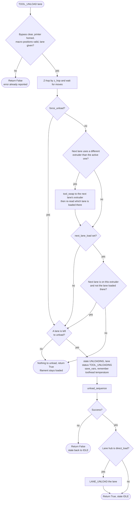

# `TOOL_UNLOAD`

**Class:** `afc`  
**File:** `extras/AFC.py`

Decides whether anything has to come out of the toolhead, then runs the unload sequence for the lane in the extruder.

## Flow

## Where it lives in code

| Step | Code |
| --- | --- |
| Method | `afc.TOOL_UNLOAD` in `extras/AFC.py` |
| Pre-checks | [`afc._check_bypass`](_check_bypass.md), `afcFunction.check_homed`, [`afc.verify_macro_positions`](verify_macro_positions.md), `afcFunction.check_absolute_mode` |
| Z-hop | [`afc.move_z_pos`](move_z_pos.md) |
| Tool swap | `AFCLane.tool_swap` ([`AFCLane.tool_swap`](../AFC_lane/tool_swap.md)), which calls [`AfcToolchanger.tool_swap`](../AFC_Toolchanger/tool_swap.md) |
| Which lane is loaded | `afcFunction.get_current_extruder_obj` and `get_current_lane_obj` |
| Temperature | [`afc.capture_toolhead_temp`](capture_toolhead_temp.md) and [`afc.restore_toolhead_temp`](restore_toolhead_temp.md) |
| Unload | [`afc.unload_sequence`](unload_sequence.md) |
| After the unload | `afcUnit.finish_unload` in `extras/AFC_unit.py` |
| Direct hub | [`afc.LANE_UNLOAD`](LANE_UNLOAD.md) |

## Notes

- Most of the branching decides whether to skip. Switching between two lanes on one shared extruder unloads, switching onto a different extruder leaves the old filament loaded.
- Called on its own, with no `next_lane_load`, it always unloads the current lane.
- On a multi-toolhead printer, unloading for a lane on another extruder first swaps tools, then unloads whatever that extruder holds. If it holds nothing, the unload is skipped.
- The toolhead temperature is restored in a `finally` block, unless the caller passes `restore_temp=False` because it manages temperature itself.
- A failure outside a print would otherwise leave the state at `UNLOADING`, so it is reset to `IDLE` before returning.

## Related

- [`afc.unload_sequence`](unload_sequence.md)
- [`afc.CHANGE_TOOL`](CHANGE_TOOL.md)
- [`afc.cmd_TOOL_UNLOAD`](cmd_TOOL_UNLOAD.md)
- [`afc.LANE_UNLOAD`](LANE_UNLOAD.md)
