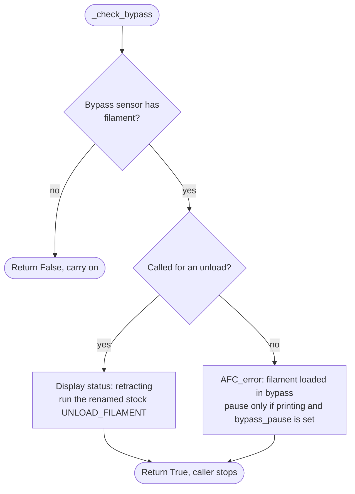

# `_check_bypass`

**Class:** `afc`  
**File:** `extras/AFC.py`

Checks whether filament is sitting in the bypass sensor. On a load it aborts the load, on an unload it runs the stock unload macro.

## Flow

## Where it lives in code

| Step | Code |
| --- | --- |
| Method | `afc._check_bypass` in `extras/AFC.py` |
| Sensor state | `afc.get_bypass_state` in `extras/AFC.py` |
| Stock unload | `afc.RENAMED_UNLOAD_FILAMENT`, run with `afc.run_script` |
| Display hook | `afc._set_display_status`, calls `_AFC_DISPLAY_STATUS` if defined |
| Error | [`afcError.AFC_error`](../AFC_error/AFC_error.md) |

## Notes

- `get_bypass_state` handles the virtual bypass switch too, and refuses to enable it while a lane is loaded.
- Everything is wrapped in a bare `try`, so a missing or broken bypass sensor means the check returns `False` and the sequence carries on.
- All of [`afc.cmd_CHANGE_TOOL`](cmd_CHANGE_TOOL.md), [`afc.CHANGE_TOOL`](CHANGE_TOOL.md), [`afc.TOOL_LOAD`](TOOL_LOAD.md), [`afc.TOOL_UNLOAD`](TOOL_UNLOAD.md) and [`afc.cmd_TOOL_UNLOAD`](cmd_TOOL_UNLOAD.md) start with this check.

## Related

- [`afc.TOOL_LOAD`](TOOL_LOAD.md)
- [`afc.TOOL_UNLOAD`](TOOL_UNLOAD.md)
