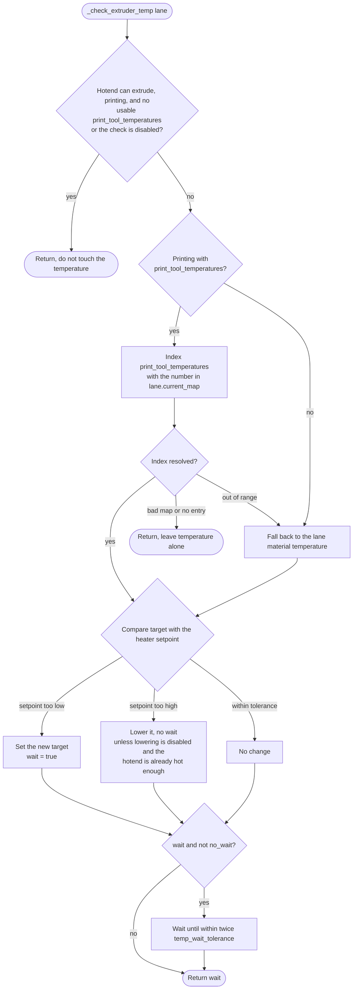

# `_check_extruder_temp`

**Class:** `afc`  
**File:** `extras/AFC.py`

Heats or cools the toolhead to the lane's target temperature before a load or unload, and waits if it had to heat. It stays out of the way during a print.

## Flow

## Where it lives in code

| Step | Code |
| --- | --- |
| Method | `afc._check_extruder_temp` in `extras/AFC.py` |
| Default temperature | `afc._get_default_material_temps`, which uses the Spoolman or configured material temperature |
| Per-tool temperatures | `afc.print_tool_temperatures`, filled from the sliced file's metadata by `print_data_metadata` in `extras/AFC_utils.py` |
| Heater | `AFCExtruder.toolhead_extruder.get_heater()` and the `heaters` object |
| Waiting | [`afc._wait_for_temp_within_tolerance`](_wait_for_temp_within_tolerance.md) |
| Settings | `temp_wait_tolerance`, `lower_extruder_temp_on_change`, `disable_print_temp_check` in `AFC.cfg` |

## Notes

- The first branch is the safety rule: during a print AFC only changes temperature when the file's own per-tool temperatures are known, since that is what the slicer would do anyway.
- The method returns whether it needed to heat. `AFCExtruder` passes `no_wait=True` when it starts a standalone toolhead load or unload, so the heater is set but the call does not block.

## Related

- [`afc._wait_for_temp_within_tolerance`](_wait_for_temp_within_tolerance.md)
- [`afc.load_sequence`](load_sequence.md)
- [`afc.unload_sequence`](unload_sequence.md)
