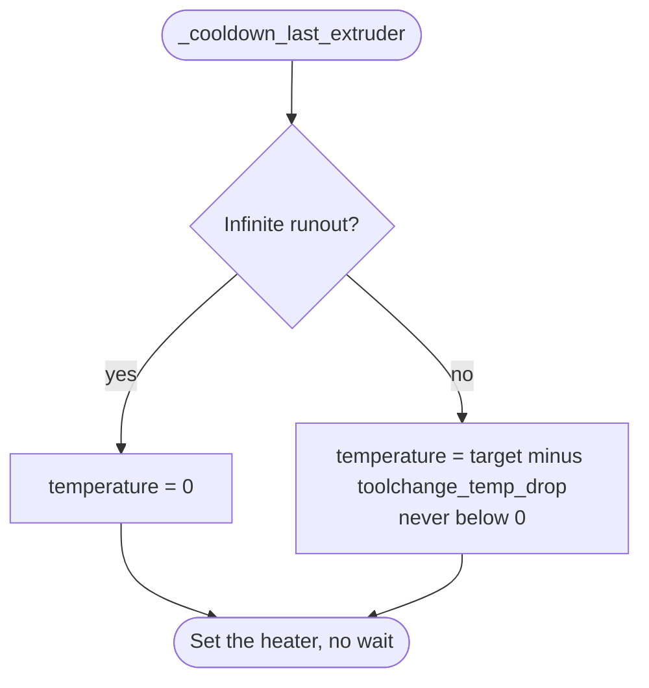

# `_cooldown_last_extruder`

**Class:** `afc`  
**File:** `extras/AFC.py`

Lowers the temperature of the extruder that was just used, either by the configured drop or all the way to zero for an infinite runout.

## Flow

## Where it lives in code

| Step | Code |
| --- | --- |
| Method | `afc._cooldown_last_extruder` in `extras/AFC.py` |
| Drop amount | `AFCExtruder.toolchange_temp_drop`, from the extruder section or `AFC.cfg` |
| Heater | `heaters` object `set_temperature` |

## Notes

- A runout lane has no filament left, so the empty hotend can be switched off. A normal change only drops the temperature, because the old tool will be used again.

## Related

- [`afc.CHANGE_TOOL`](CHANGE_TOOL.md)
- [`afc._heat_next_extruder`](_heat_next_extruder.md)
