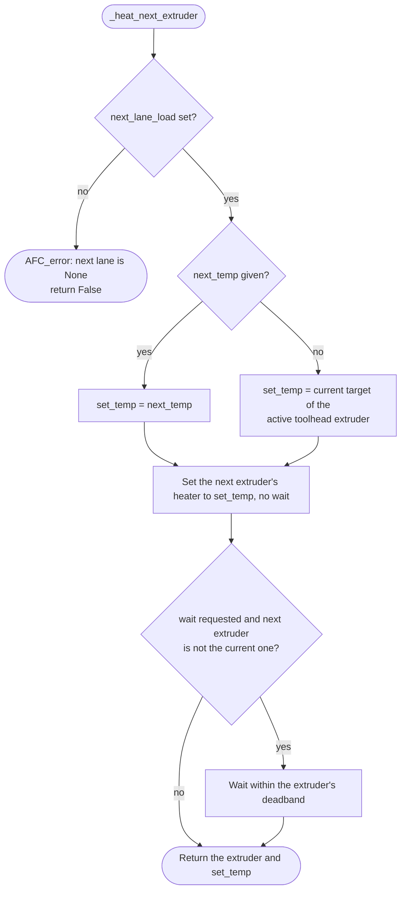

# `_heat_next_extruder`

**Class:** `afc`  
**File:** `extras/AFC.py`

Starts heating the extruder of the next lane during a tool change, so it is hot by the time the load starts.

## Flow

## Where it lives in code

| Step | Code |
| --- | --- |
| Method | `afc._heat_next_extruder` in `extras/AFC.py` |
| Next extruder | `afc.lanes[next_lane_load].extruder_obj`, set by [`afc.CHANGE_TOOL`](CHANGE_TOOL.md) |
| Heater | `heaters` object `set_temperature` |
| Waiting | [`afc._wait_for_temp_within_tolerance`](_wait_for_temp_within_tolerance.md) |
| Error | [`afcError.AFC_error`](../AFC_error/AFC_error.md) |

## Notes

- [`afc.CHANGE_TOOL`](CHANGE_TOOL.md) calls it with `wait=False`, then does the unload while the next extruder heats, and waits afterwards in its own step.

## Related

- [`afc.CHANGE_TOOL`](CHANGE_TOOL.md)
- [`afc._cooldown_last_extruder`](_cooldown_last_extruder.md)
