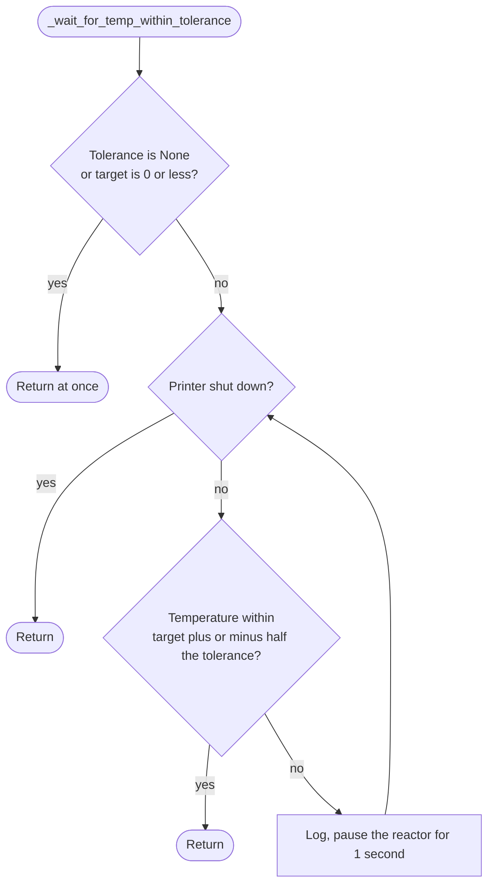

# `_wait_for_temp_within_tolerance`

**Class:** `afc`  
**File:** `extras/AFC.py`

Blocks until a heater is within a tolerance of a target temperature, checking once a second.

## Flow

## Where it lives in code

| Step | Code |
| --- | --- |
| Method | `afc._wait_for_temp_within_tolerance` in `extras/AFC.py` |
| Heater read | `heater.get_temp` |
| Pause | `reactor.pause`, so the printer keeps running other work |

## Notes

- The tolerance is the full band, so the accepted range is half the tolerance either side of the target. Callers pass `temp_wait_tolerance * 2` or the extruder's `deadband`.

## Related

- [`afc._check_extruder_temp`](_check_extruder_temp.md)
- [`afc.CHANGE_TOOL`](CHANGE_TOOL.md)
