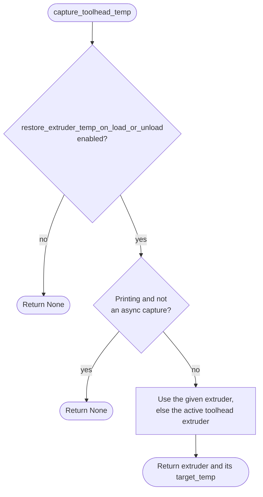

# `capture_toolhead_temp`

**Class:** `afc`  
**File:** `extras/AFC.py`

Remembers the toolhead's current target temperature before a load or unload, so it can be put back afterwards.

## Flow

## Where it lives in code

| Step | Code |
| --- | --- |
| Method | `afc.capture_toolhead_temp` in `extras/AFC.py` |
| Setting | `afc.restore_extruder_temp_on_load_or_unload` in `AFC.cfg` |
| Active extruder | `afc.toolhead.get_extruder` |
| Used by | [`afc.TOOL_LOAD`](TOOL_LOAD.md) and [`afc.TOOL_UNLOAD`](TOOL_UNLOAD.md) |

## Notes

- It returns `None` while printing so that the print's own temperature is never overwritten by a stale value.

## Related

- [`afc.restore_toolhead_temp`](restore_toolhead_temp.md)
