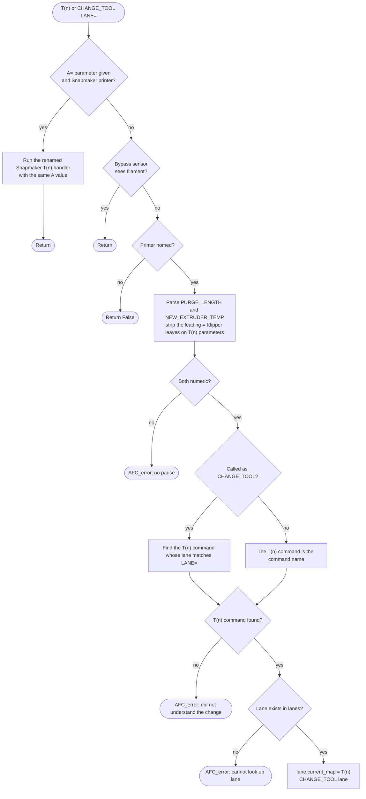

# `cmd_CHANGE_TOOL`

**Class:** `afc`  
**File:** `extras/AFC.py`

Gcode entry point for `T0`, `T1` and so on, and for `CHANGE_TOOL LANE=`. It turns the command into a lane and hands it to [`afc.CHANGE_TOOL`](CHANGE_TOOL.md).

## Flow

## Where it lives in code

| Step | Code |
| --- | --- |
| Command handler | `afc.cmd_CHANGE_TOOL` in `extras/AFC.py` |
| Bypass check | [`afc._check_bypass`](_check_bypass.md) |
| Homed check | `afcFunction.check_homed` in `extras/AFC_functions.py` |
| T(n) to lane lookup | `afc.tool_cmds` (T(n) to lane name) and `afc.lanes` |
| Hand off | [`afc.CHANGE_TOOL`](CHANGE_TOOL.md) |

## Notes

- Snapmaker's own `T(n)` macro is renamed with a leading underscore at startup. When a `T(n)` arrives with an `A=` value, AFC passes it straight through, because that form activates the extruder without a tool change.
- `lane.current_map` is set to the command that was used, so the lane knows which `T(n)` selected it.

## Related

- [`afc.CHANGE_TOOL`](CHANGE_TOOL.md)
- [`afc._check_bypass`](_check_bypass.md)
