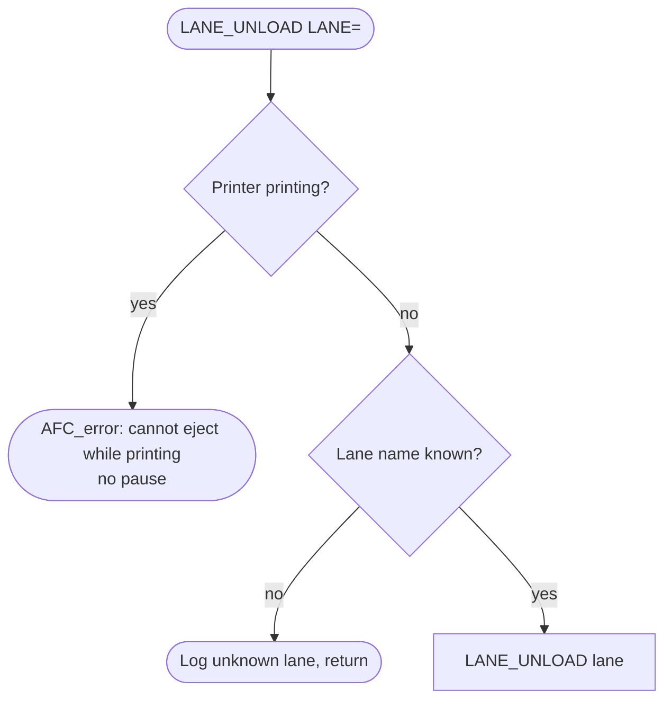

# `cmd_LANE_UNLOAD`

**Class:** `afc`  
**File:** `extras/AFC.py`

Gcode entry point for `LANE_UNLOAD LANE=`. Refuses while printing, otherwise ejects the lane through [`afc.LANE_UNLOAD`](LANE_UNLOAD.md).

## Flow

## Where it lives in code

| Step | Code |
| --- | --- |
| Command handler | `afc.cmd_LANE_UNLOAD` in `extras/AFC.py` |
| Printing check | `afcFunction.is_printing` in `extras/AFC_functions.py` |
| Error | [`afcError.AFC_error`](../AFC_error/AFC_error.md) |
| Eject | [`afc.LANE_UNLOAD`](LANE_UNLOAD.md) |

## Notes

- The printing check lives here and not in [`afc.LANE_UNLOAD`](LANE_UNLOAD.md), because infinite runout and paused runouts call [`afc.LANE_UNLOAD`](LANE_UNLOAD.md) directly while a print is paused.

## Related

- [`afc.LANE_UNLOAD`](LANE_UNLOAD.md)
