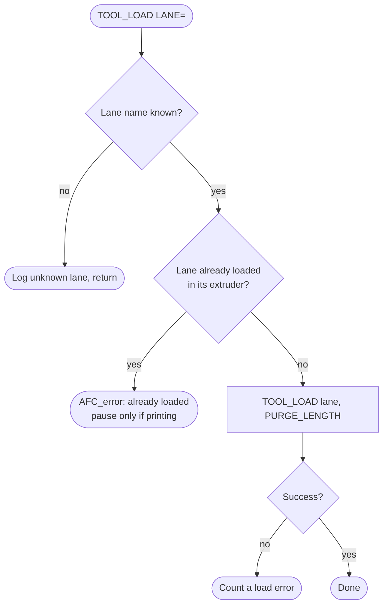

# `cmd_TOOL_LOAD`

**Class:** `afc`  
**File:** `extras/AFC.py`

Gcode entry point for `TOOL_LOAD LANE=`. Loads the named lane into the toolhead.

## Flow

## Where it lives in code

| Step | Code |
| --- | --- |
| Command handler | `afc.cmd_TOOL_LOAD` in `extras/AFC.py` |
| Loaded check | `AFCExtruder.lane_loaded` in `extras/AFC_extruder.py` |
| Load | [`afc.TOOL_LOAD`](TOOL_LOAD.md) |
| Error | [`afcError.AFC_error`](../AFC_error/AFC_error.md) |
| Stats | `afc.afc_stats.increase_load_error_count` |

## Notes

- `PURGE_LENGTH` is read as a string and passed to [`afc.TOOL_LOAD`](TOOL_LOAD.md), which hands it to [`afc.do_poop_kick_wipe`](do_poop_kick_wipe.md).
- This command loads a lane, it does not unload another one first. If another lane is already loaded on the same extruder, [`afc.TOOL_LOAD`](TOOL_LOAD.md) unloads it as part of its own checks.

## Related

- [`afc.TOOL_LOAD`](TOOL_LOAD.md)
