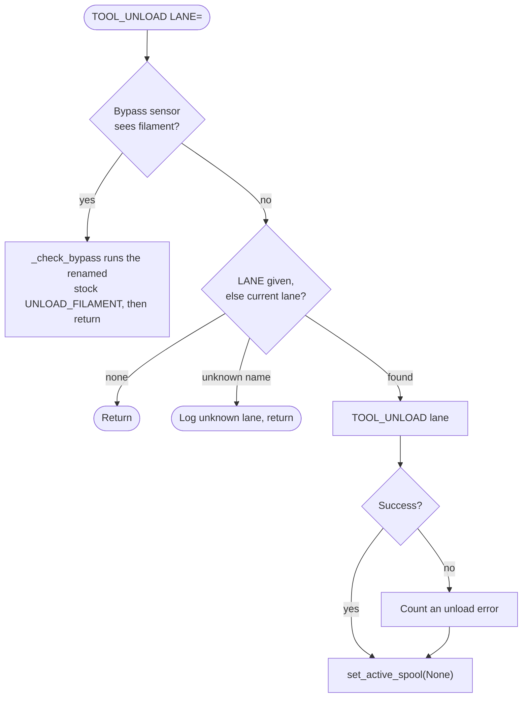

# `cmd_TOOL_UNLOAD`

**Class:** `afc`  
**File:** `extras/AFC.py`

Gcode entry point for `TOOL_UNLOAD LANE=`. Unloads the named lane, or the currently loaded lane when none is given.

## Flow

## Where it lives in code

| Step | Code |
| --- | --- |
| Command handler | `afc.cmd_TOOL_UNLOAD` in `extras/AFC.py` |
| Bypass handling | [`afc._check_bypass`](_check_bypass.md) with `unload=True` |
| Current lane | `afc.current` |
| Unload | [`afc.TOOL_UNLOAD`](TOOL_UNLOAD.md) |
| Stats | `afc.afc_stats.increase_unload_error_count` |
| Spool | `AFCSpool.set_active_spool` in `extras/AFC_spool.py` |

## Notes

- The active spool is cleared even when the unload failed, because the command means the user took the filament out of the toolhead.
- `force_unload` is not set here, so [`afc.TOOL_UNLOAD`](TOOL_UNLOAD.md) runs its normal checks, including the next-lane logic, with `next_lane_load` left as `None`.

## Related

- [`afc.TOOL_UNLOAD`](TOOL_UNLOAD.md)
- [`afc._check_bypass`](_check_bypass.md)
