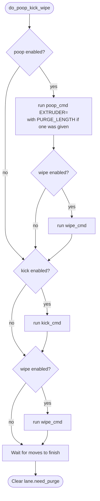

# `do_poop_kick_wipe`

**Class:** `afc`  
**File:** `extras/AFC.py`

Runs the purge, kick and wipe macros after a load. Each one only runs if the user enabled it.

## Flow

## Where it lives in code

| Step | Code |
| --- | --- |
| Method | `afc.do_poop_kick_wipe` in `extras/AFC.py` |
| Macros | `afc.poop_cmd`, `afc.kick_cmd`, `afc.wipe_cmd`, run with `afc.run_script` |
| Built-in macros | `AFC_POOP`, `AFC_KICK`, `AFC_BRUSH` in `config/macros/`, variables in `AFC_Macro_Vars.cfg` |
| Position checks | [`afc.verify_macro_positions`](verify_macro_positions.md) |

## Notes

- With poop and wipe both on, wipe runs twice: once straight after the purge and once after the kick.
- `lane.need_purge` is always cleared at the end, even when poop is off.
- [`afc.load_sequence`](load_sequence.md) does not call this. [`afc.TOOL_LOAD`](TOOL_LOAD.md) does, so a gear-only load never purges.

## Related

- [`afc.TOOL_LOAD`](TOOL_LOAD.md)
