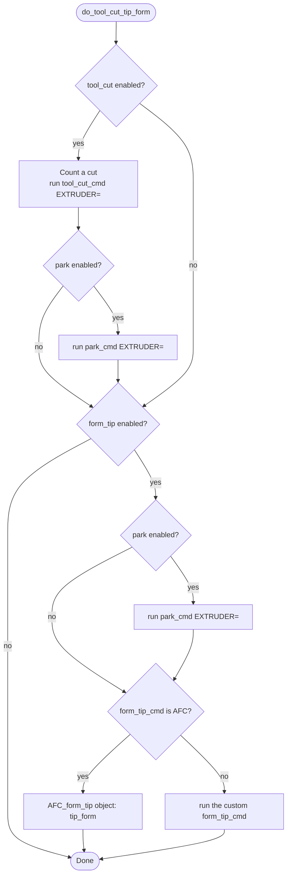

# `do_tool_cut_tip_form`

**Class:** `afc`  
**File:** `extras/AFC.py`

Runs the optional cut, park and tip-forming macros during an unload.

## Flow

## Where it lives in code

| Step | Code |
| --- | --- |
| Method | `afc.do_tool_cut_tip_form` in `extras/AFC.py` |
| Cut count | `AFCExtruderStats.increase_cut_total` in `extras/AFC_extruder.py` |
| Macros | `afc.tool_cut_cmd`, `afc.park_cmd`, `afc.form_tip_cmd`, run with `afc.run_script` |
| Built-in tip forming | `AFC_form_tip` object in `extras/AFC_form_tip.py` |
| Position checks | [`afc.verify_macro_positions`](verify_macro_positions.md) |

## Notes

- Each step is only a macro call, so users can replace any of them in `AFC.cfg`.
- Park runs after the cut and again before tip forming, so the toolhead is at the park position for both.

## Related

- [`afc.unload_sequence`](unload_sequence.md)
