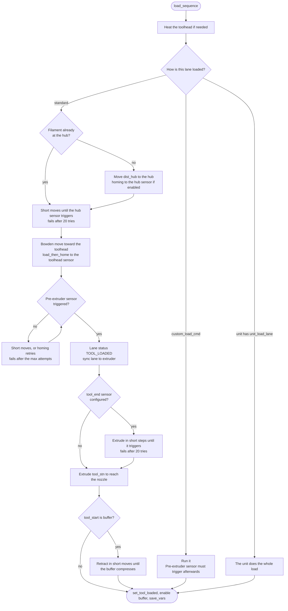

# `load_sequence`

**Class:** `afc`  
**File:** `extras/AFC.py`

The physical load: feed filament to the hub, through the bowden to the toolhead sensor, then into the nozzle. Units can replace all or part of it.

## Flow

## Where it lives in code

| Step | Code |
| --- | --- |
| Method | `afc.load_sequence` in `extras/AFC.py` |
| Heating | [`afc._check_extruder_temp`](_check_extruder_temp.md) |
| Custom path | `AFCLane.custom_load_cmd`, then `AFCLane.get_toolhead_pre_sensor_state` |
| Unit-owned path | `unit_load_lane` on the unit class, when it defines one |
| To the hub | [`afcUnit.move_to_hub`](../AFC_unit/move_to_hub.md) |
| Direct hub lanes | [`afcUnit.load_then_home`](../AFC_unit/load_then_home.md) straight to the toolhead endstop |
| Bowden move | [`afcUnit.load_then_home`](../AFC_unit/load_then_home.md) |
| Toolhead sensor loop | [`AFCLane.move_to`](../AFC_lane/move_to.md) with `AFCLane.get_toolhead_endstop` |
| Extruder moves | [`afc.move_e_pos`](move_e_pos.md) |
| Buffer ramming | `AFCLane.move_advanced`, `unsync_to_extruder`, `sync_to_extruder` |
| Final state | [`AFCLane.set_tool_loaded`](../AFC_lane/set_tool_loaded.md), `AFCLane.enable_buffer` |
| Failures | [`afcError.handle_lane_failure`](../AFC_error/handle_lane_failure.md), [`afcError.AFC_error`](../AFC_error/AFC_error.md) |

## Notes

- Each sensor is a checkpoint. The sequence never assumes filament arrived, it moves until the sensor says so or gives up.
- Direct-hub lanes skip the hub steps and move straight to the toolhead sensor.
- With `load_to_gears` the sequence ends after the sync step, before the `tool_stn` move.
- A virtual toolhead sensor (a standalone toolhead with no switch) skips the sensor loop, because there is no hardware to confirm against. `AFCExtruder.has_toolhead_sensor` decides this.
- Every failure raises a lane failure with instructions, such as running `SET_LANE_LOADED` or `AFC_RESET`.

## Related

- [`afc.TOOL_LOAD`](TOOL_LOAD.md)
- [`afcUnit.move_to_hub`](../AFC_unit/move_to_hub.md)
- [`afcUnit.load_then_home`](../AFC_unit/load_then_home.md)
