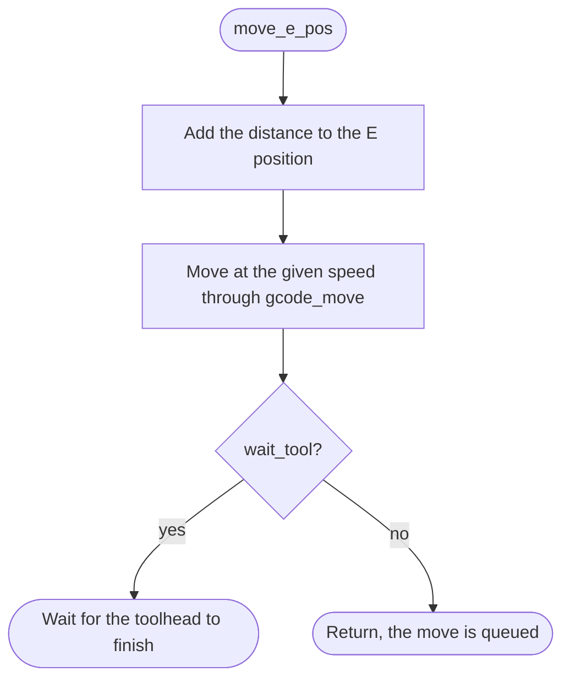

# `move_e_pos`

**Class:** `afc`  
**File:** `extras/AFC.py`

Moves the extruder by a distance, positive to extrude and negative to retract.

## Flow

## Where it lives in code

| Step | Code |
| --- | --- |
| Method | `afc.move_e_pos` in `extras/AFC.py` |
| Move | `gcode_move.move_with_transform` |
| Wait | `afc.toolhead.wait_moves` |
| Used by | [`afc.load_sequence`](load_sequence.md) and [`afc.unload_sequence`](unload_sequence.md) |

## Notes

- The lane's stepper is synced to the extruder first (`AFCLane.sync_to_extruder`), so this one move drives both the extruder gears and the lane.

## Related

- [`afc.load_sequence`](load_sequence.md)
- [`afc.unload_sequence`](unload_sequence.md)
