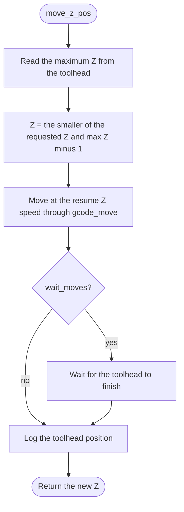

# `move_z_pos`

**Class:** `afc`  
**File:** `extras/AFC.py`

Moves Z to a height, capped just under the printer's maximum, and returns the Z it actually moved to.

## Flow

## Where it lives in code

| Step | Code |
| --- | --- |
| Method | `afc.move_z_pos` in `extras/AFC.py` |
| Maximum Z | `afc.toolhead.get_status`, key `axis_maximum` |
| Move | `gcode_move.move_with_transform` |
| Speed | `afc._get_resume_speedz` |
| Used by | [`afc.TOOL_UNLOAD`](TOOL_UNLOAD.md), [`afc.restore_pos`](restore_pos.md) and [`afcError.cmd_AFC_RESUME`](../AFC_error/cmd_AFC_RESUME.md) |

## Notes

- The cap stops a z-hop from driving the gantry into the top of the machine.

## Related

- [`afc.restore_pos`](restore_pos.md)
