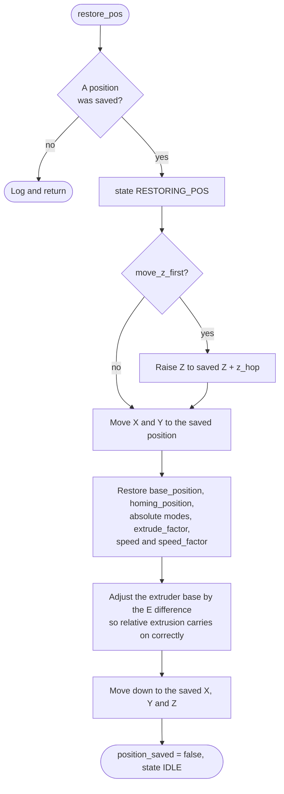

# `restore_pos`

**Class:** `afc`  
**File:** `extras/AFC.py`

Moves the toolhead back to the position saved by [`afc.save_pos`](save_pos.md) and restores the gcode state: lift, move over, restore offsets, lower.

## Flow

## Where it lives in code

| Step | Code |
| --- | --- |
| Method | `afc.restore_pos` in `extras/AFC.py` |
| Z move | [`afc.move_z_pos`](move_z_pos.md) |
| Moves | `gcode_move.move_with_transform`, speeds from `afc._get_resume_speed` and `_get_resume_speedz` |
| Absolute extrude | `set_gcode_absolute_extrude` in `extras/AFC_functions.py` |
| Saved values | Set by [`afc.save_pos`](save_pos.md) |

## Notes

- The final move goes through `move_with_transform`, so any active gcode transform applies. That is how a toolchanger's per-tool offset ends up applied to the restored position.
- [`afc.CHANGE_TOOL`](CHANGE_TOOL.md) passes `restore_pos=False` for infinite runout and restores itself after the new lane is loaded.
- [`afcError.cmd_AFC_RESUME`](../AFC_error/cmd_AFC_RESUME.md) calls this with `move_z_first=False` because it has already raised Z.

## Related

- [`afc.save_pos`](save_pos.md)
- [`afc.CHANGE_TOOL`](CHANGE_TOOL.md)
