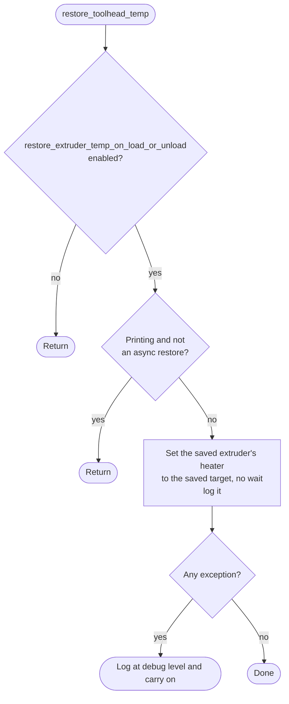

# `restore_toolhead_temp`

**Class:** `afc`  
**File:** `extras/AFC.py`

Puts the toolhead target temperature back to the value saved by [`afc.capture_toolhead_temp`](capture_toolhead_temp.md).

## Flow

## Where it lives in code

| Step | Code |
| --- | --- |
| Method | `afc.restore_toolhead_temp` in `extras/AFC.py` |
| Heater | `heaters` object `set_temperature` |
| Used by | [`afc.TOOL_LOAD`](TOOL_LOAD.md) and [`afc.TOOL_UNLOAD`](TOOL_UNLOAD.md), inside `finally` blocks |

## Notes

- `async_restore=True` allows a restore during a print. Toolchangers use it to bring other toolheads back to temperature.

## Related

- [`afc.capture_toolhead_temp`](capture_toolhead_temp.md)
