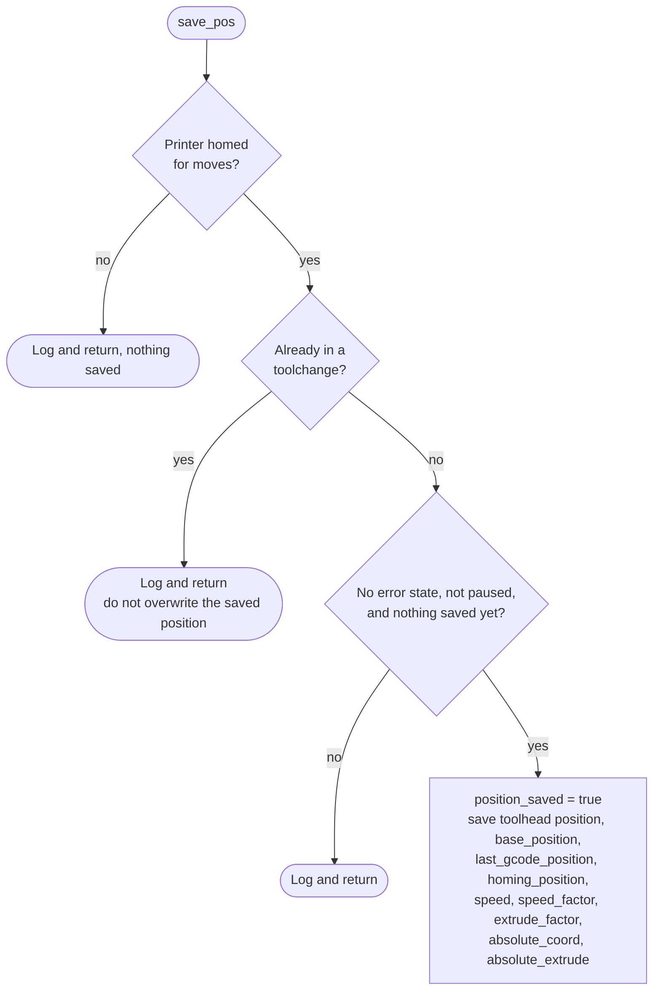

# `save_pos`

**Class:** `afc`  
**File:** `extras/AFC.py`

Saves the toolhead position and gcode state before a tool change or an error pause, so it can be restored afterwards.

## Flow

## Where it lives in code

| Step | Code |
| --- | --- |
| Method | `afc.save_pos` in `extras/AFC.py` |
| Homed check | `afcFunction.is_homed` and `is_paused` in `extras/AFC_functions.py` |
| Gcode state read | `gcode_move` object: `base_position`, `last_position`, `homing_position`, `speed`, `speed_factor`, `extrude_factor`, `absolute_coord` |
| Absolute extrude | `get_gcode_absolute_extrude` in `extras/AFC_functions.py`, which handles Klipper and Kalico naming |
| Saved values | `afc.last_toolhead_position`, `afc.last_gcode_position`, `afc.base_position`, `afc.homing_position` |

## Notes

- Only the first call in an incident saves. That is the point: an error during a tool change calls it again and must not capture a position that is already mid-change.
- [`afcError.set_error_state`](../AFC_error/set_error_state.md) also calls it the first time an error state is entered.

## Related

- [`afc.restore_pos`](restore_pos.md)
- [`afc.CHANGE_TOOL`](CHANGE_TOOL.md)
- [`afcError.cmd_AFC_RESUME`](../AFC_error/cmd_AFC_RESUME.md)
