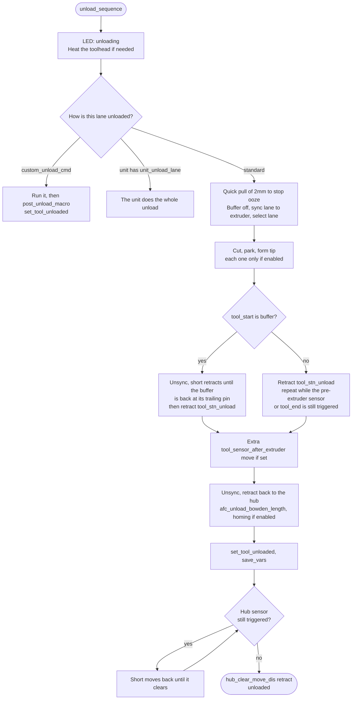

# `unload_sequence`

**Class:** `afc`  
**File:** `extras/AFC.py`

The physical unload: retract out of the extruder, back through the bowden to the hub, then clear the hub sensor. Units can replace all or part of it.

## Flow

## Where it lives in code

| Step | Code |
| --- | --- |
| Method | `afc.unload_sequence` in `extras/AFC.py` |
| LEDs | `afcUnit.lane_unloading` in `extras/AFC_unit.py` |
| Heating | [`afc._check_extruder_temp`](_check_extruder_temp.md) |
| Custom path | `AFCLane.custom_unload_cmd`, `afc.post_unload_macro`, [`AFCLane.set_tool_unloaded`](../AFC_lane/set_tool_unloaded.md) |
| Unit-owned path | `unit_unload_lane` on the unit class, when it defines one |
| Extruder moves | [`afc.move_e_pos`](move_e_pos.md) |
| Cut, park, tip | [`afc.do_tool_cut_tip_form`](do_tool_cut_tip_form.md) |
| Sync and select | `AFCLane.sync_to_extruder`, `unsync_to_extruder`, `select_lane`, `disable_buffer` |
| Buffer check | `AFCLane.get_trailing` and `move_advanced` |
| Sensor check | `AFCLane.get_toolhead_pre_sensor_state` and `AFCExtruder.tool_end_state` |
| Back to the hub | [`afcUnit.move_to_hub`](../AFC_unit/move_to_hub.md) |
| Direct hub lanes | [`AFCLane.move_to`](../AFC_lane/move_to.md) to `lane.load_es` |
| Failures | [`afcError.handle_lane_failure`](../AFC_error/handle_lane_failure.md), [`afcError.AFC_error`](../AFC_error/AFC_error.md) |

## Notes

- Retry loops use `tool_max_unload_attempts`. When a limit is hit the lane goes to the failure path instead of continuing.
- `set_tool_unloaded` runs as soon as filament is behind the extruder, before the hub is cleared. A failure after that point leaves the lane marked unloaded.
- The hub-clearing loop uses short moves, or at most two homing moves when homing is enabled.
- Standalone toolheads leave the sensor loop after one retract.
- Direct-hub lanes retract to the load sensor instead of a hub.

## Related

- [`afc.TOOL_UNLOAD`](TOOL_UNLOAD.md)
- [`afc.do_tool_cut_tip_form`](do_tool_cut_tip_form.md)
- [`afcUnit.move_to_hub`](../AFC_unit/move_to_hub.md)
