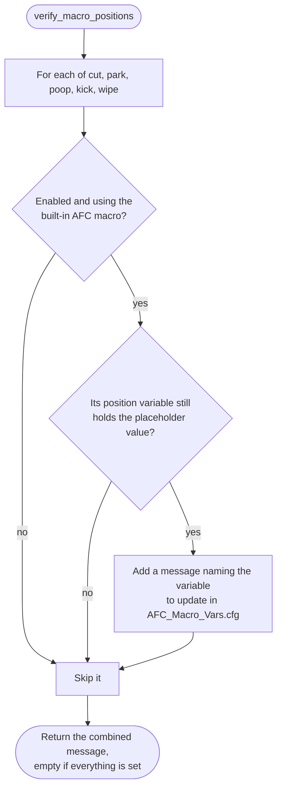

# `verify_macro_positions`

**Class:** `afc`  
**File:** `extras/AFC.py`

Checks that the cut, park, purge, kick and wipe macros have had their positions set, when those macros are enabled.

## Flow

## Where it lives in code

| Step | Code |
| --- | --- |
| Method | `afc.verify_macro_positions` in `extras/AFC.py` |
| Variables checked | `pin_loc_xy`, `park_loc_xy`, `purge_loc_xy`, `kick_start_loc`, `brush_loc` |
| Macro objects | `_AFC_CUT_TIP_VARS`, `_AFC_PARK_VARS`, `_AFC_POOP_VARS`, `_AFC_KICK_VARS`, `_AFC_BRUSH_VARS`, defined in `config/AFC_Macro_Vars.cfg` |
| Used by | [`afc.TOOL_LOAD`](TOOL_LOAD.md) and [`afc.TOOL_UNLOAD`](TOOL_UNLOAD.md), which abort with the message |

## Notes

- A user who replaces a built-in macro with their own command is not checked, because the macro name no longer matches.

## Related

- [`afc.TOOL_LOAD`](TOOL_LOAD.md)
- [`afc.TOOL_UNLOAD`](TOOL_UNLOAD.md)
