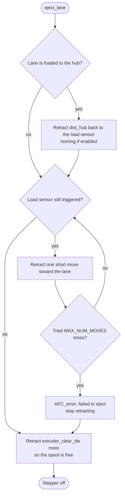

# `eject_lane`

**Class:** `afcBoxTurtle`  
**File:** `extras/AFC_BoxTurtle.py`

Retracts a lane's filament out of the unit so the spool can be removed.

## Flow

## Where it lives in code

| Step | Code |
| --- | --- |
| Method | `afcBoxTurtle.eject_lane` in `extras/AFC_BoxTurtle.py` |
| Base class | `afcUnit.eject_lane` in `extras/AFC_unit.py`, a placeholder |
| Homing retract | [`AFCLane.move_to`](../AFC_lane/move_to.md) to `AFCLane.load_es` |
| Short retracts | `AFCLane.move_advanced` with `AssistActive.YES` |
| Limit | `afcBoxTurtle.MAX_NUM_MOVES` |
| Stepper | `AFCLane.do_enable(False)` in a `finally` block |
| Caller | [`afc.LANE_UNLOAD`](../AFC/LANE_UNLOAD.md) |

## Notes

- The stepper is switched off even if a move raises, so a failed eject does not leave the motor energized.

## Related

- [`afc.LANE_UNLOAD`](../AFC/LANE_UNLOAD.md)
- [`afcBoxTurtle.prep_load`](prep_load.md)
