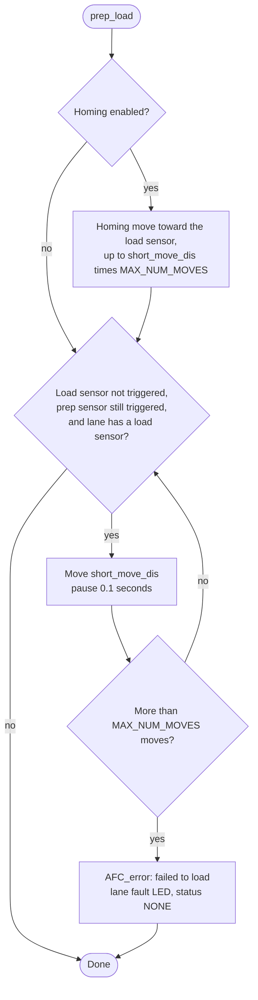

# `prep_load`

**Class:** `afcBoxTurtle`  
**File:** `extras/AFC_BoxTurtle.py`

Feeds a freshly inserted spool until the load sensor triggers.

## Flow

## Where it lives in code

| Step | Code |
| --- | --- |
| Method | `afcBoxTurtle.prep_load` in `extras/AFC_BoxTurtle.py` |
| Base class | `afcUnit.prep_load` in `extras/AFC_unit.py`, a placeholder that logs that it is not defined |
| Homing move | [`AFCLane.move_to`](../AFC_lane/move_to.md) with `AFCLane.load_es` |
| Short moves | `AFCLane.move` |
| Sensors | `AFCLane.raw_load_state` and `prep_state` |
| Limit | `afcBoxTurtle.MAX_NUM_MOVES` |
| Error | [`afcError.AFC_error`](../AFC_error/AFC_error.md), `afcUnit.lane_fault` |
| Caller | [`AFCLane.prep_callback`](../AFC_lane/prep_callback.md) |

## Notes

- Other units, such as HTLF, ACE, Vivid and CFS, implement this in their own file with the same signature.

## Related

- [`AFCLane.prep_callback`](../AFC_lane/prep_callback.md)
- [`afcBoxTurtle.prep_post_load`](prep_post_load.md)
