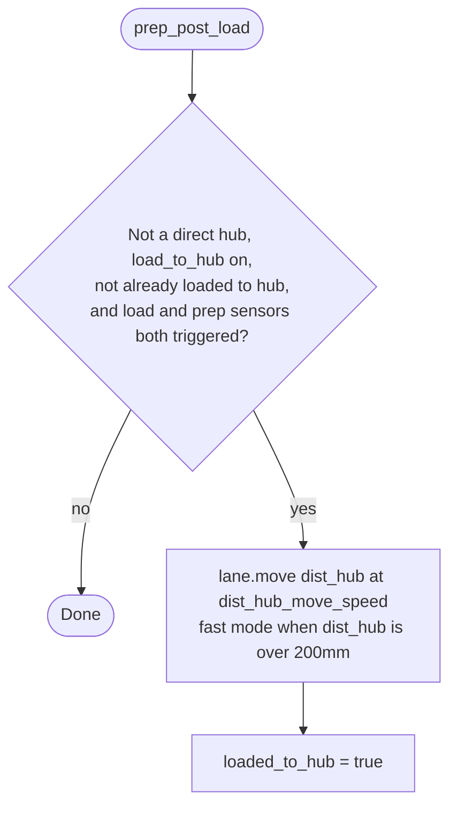

# `prep_post_load`

**Class:** `afcBoxTurtle`  
**File:** `extras/AFC_BoxTurtle.py`

After a spool reaches the load sensor, optionally feeds it on to the hub.

## Flow

## Where it lives in code

| Step | Code |
| --- | --- |
| Method | `afcBoxTurtle.prep_post_load` in `extras/AFC_BoxTurtle.py` |
| Base class | `afcUnit.prep_post_load` in `extras/AFC_unit.py`, a placeholder |
| Move | `AFCLane.move` |
| Settings | `load_to_hub`, `dist_hub`, `dist_hub_move_speed`, `dist_hub_move_accel` |
| Caller | [`AFCLane.prep_callback`](../AFC_lane/prep_callback.md) |

## Notes

- Moving to the hub here means [`afc.load_sequence`](../AFC/load_sequence.md) later only has to add the short moves to the hub sensor, so the first toolhead load is quicker.

## Related

- [`afcBoxTurtle.prep_load`](prep_load.md)
- [`AFCLane.prep_callback`](../AFC_lane/prep_callback.md)
