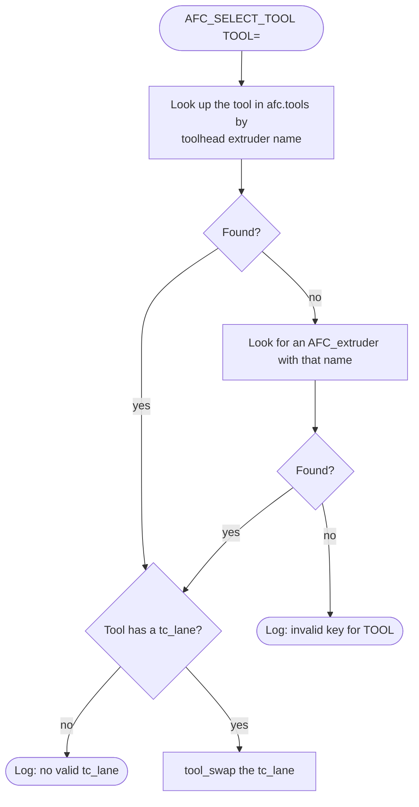

# `cmd_AFC_SELECT_TOOL`

**Class:** `AfcToolchanger`  
**File:** `extras/AFC_Toolchanger.py`

Gcode command that selects a toolhead by extruder name. It finds the tool's lane and swaps to it.

## Flow

## Where it lives in code

| Step | Code |
| --- | --- |
| Command handler | `AfcToolchanger.cmd_AFC_SELECT_TOOL` in `extras/AFC_Toolchanger.py` |
| Tool table | `afc.tools`, keyed by toolhead extruder name, filled by `AFCExtruder.handle_connect` |
| Lane to swap to | `AFCExtruder.tc_lane`, the lane an extruder gets when it has no unit of its own |
| Swap | [`AfcToolchanger.tool_swap`](tool_swap.md) |
| Used by | `afcFunction` calibration commands in `extras/AFC_functions.py` |

## Notes

- Both `extruder1` and the AFC_extruder name, such as `e1`, work, because an AFC_extruder can map to a toolhead extruder with a different name.

## Related

- [`AfcToolchanger.tool_swap`](tool_swap.md)
- [`AfcToolchanger.cmd_AFC_UNSELECT_TOOL`](cmd_AFC_UNSELECT_TOOL.md)
