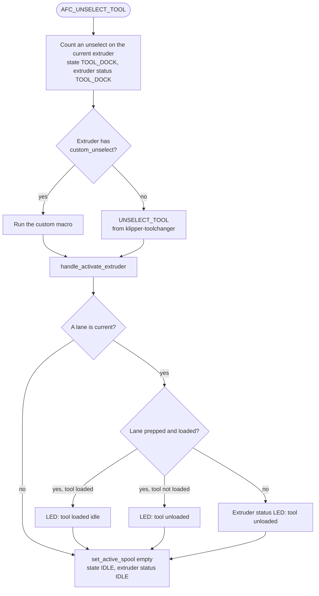

# `cmd_AFC_UNSELECT_TOOL`

**Class:** `AfcToolchanger`  
**File:** `extras/AFC_Toolchanger.py`

Gcode command that parks the current tool without picking up another one.

## Flow

## Where it lives in code

| Step | Code |
| --- | --- |
| Command handler | `AfcToolchanger.cmd_AFC_UNSELECT_TOOL` in `extras/AFC_Toolchanger.py` |
| Current extruder and lane | `afcFunction.get_current_extruder_obj` and `get_current_lane_obj` |
| Park command | `AFCExtruder.custom_unselect`, else the `UNSELECT_TOOL` command from klipper-toolchanger |
| Lane sync | [`afcFunction.handle_activate_extruder`](../AFC_functions/handle_activate_extruder.md) |
| LEDs | `afcUnit.lane_tool_loaded_idle` and `lane_tool_unloaded`, `AFCExtruder.set_status_led` |
| Spool | `AFCSpool.set_active_spool` |

## Notes

- Nothing is loaded or unloaded. The filament stays in the parked toolhead, and only AFC's idea of the active tool is cleared.

## Related

- [`AfcToolchanger.tool_swap`](tool_swap.md)
- [`AfcToolchanger.cmd_AFC_SELECT_TOOL`](cmd_AFC_SELECT_TOOL.md)
