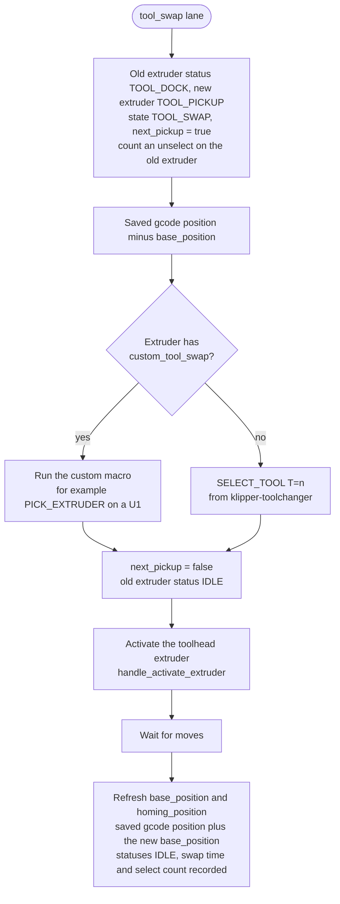

# `tool_swap`

**Class:** `AfcToolchanger`  
**File:** `extras/AFC_Toolchanger.py`

Swaps to the toolhead that holds a lane. It parks the old tool, picks up the new one, and keeps the saved print position valid across the change.

## Flow

## Where it lives in code

| Step | Code |
| --- | --- |
| Method | `AfcToolchanger.tool_swap` in `extras/AFC_Toolchanger.py` |
| Statuses | `State.TOOL_DOCK`, `TOOL_SWAP`, `TOOL_PICKUP` in `extras/AFC.py` |
| Previous tool | `afcFunction.get_current_extruder_obj` |
| Unselect count | `AfcToolchanger._increase_unselect`, `AFCExtruderStats.tool_unselected` |
| Tool number | Parsed from `AFCExtruder.th_extruder_name`: `extruder` is 0, `extruder3` is 3 |
| Swap command | `AFCExtruder.custom_tool_swap`, else the `SELECT_TOOL` command from klipper-toolchanger |
| Extruder activation | `AFCLane.activate_toolhead_extruder`, which calls `toolhead.set_extruder` and sends `extruder:activate_extruder` |
| Lane sync | [`afcFunction.handle_activate_extruder`](../AFC_functions/handle_activate_extruder.md) |
| Position | `afc.last_gcode_position`, `afc.base_position`, `afc.homing_position`, `afc.gcode_move` |
| Stats | `AFCExtruderStats.tool_selected`, `afc.afc_stats.average_tool_swap_time` |
| Callers | [`AFCLane.tool_swap`](../AFC_lane/tool_swap.md) and [`AfcToolchanger.cmd_AFC_SELECT_TOOL`](cmd_AFC_SELECT_TOOL.md) |

## Notes

- The saved position is shifted by `base_position` on the way in and back on the way out, so the same gcode position survives a swap that changes offsets.
- This page describes the `DEV` flow, which hands the physical swap to klipper-toolchanger's `SELECT_TOOL`. A branch that replaces it with AFC's own dock and pickup would change only the `SELECT_TOOL` step.
- `handle_activate_extruder` also runs through the `extruder:activate_extruder` event, which is why lane motors, buffers and LEDs follow the active toolhead. The explicit call afterwards makes sure it has happened.

## Related

- [`AFCLane.tool_swap`](../AFC_lane/tool_swap.md)
- [`afcFunction.handle_activate_extruder`](../AFC_functions/handle_activate_extruder.md)
- [`AfcToolchanger.cmd_AFC_UNSELECT_TOOL`](cmd_AFC_UNSELECT_TOOL.md)
