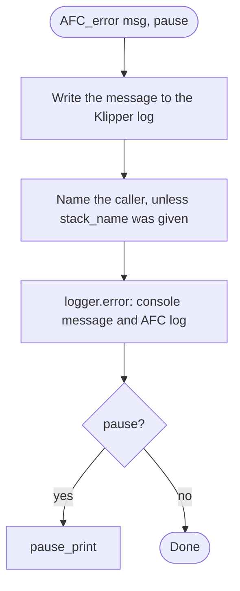

# `AFC_error`

**Class:** `afcError`  
**File:** `extras/AFC_error.py`

The standard way to report a problem. It logs the message and, if asked, pauses the print.

## Flow

## Where it lives in code

| Step | Code |
| --- | --- |
| Method | `afcError.AFC_error` in `extras/AFC_error.py` |
| Caller name | The calling function name from `inspect`, so the log shows which step failed |
| Logger | `AFC_logger.error` in `extras/AFC_logger.py` |
| Pause | [`afcError.pause_print`](pause_print.md) |

## Notes

- Callers choose `pause`. Most use `afc.function.in_print()`, so outside a print the message is only shown.
- [`afcError.handle_lane_failure`](handle_lane_failure.md) calls this and passes its own caller's name as `stack_name`.

## Related

- [`afcError.pause_print`](pause_print.md)
- [`afcError.handle_lane_failure`](handle_lane_failure.md)
