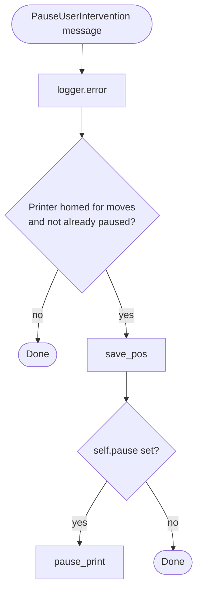

# `PauseUserIntervention`

**Class:** `afcError`  
**File:** `extras/AFC_error.py`

Logs a message and pauses the print for the user, but only when the printer is homed and not already paused.

## Flow

## Where it lives in code

| Step | Code |
| --- | --- |
| Method | `afcError.PauseUserIntervention` in `extras/AFC_error.py` |
| Checks | `afcFunction.is_homed` and `is_paused` |
| Position | [`afc.save_pos`](../AFC/save_pos.md) |
| Pause | [`afcError.pause_print`](pause_print.md) |
| Flag | `afcError.pause`, set by [`afcError.fix`](fix.md) and cleared by [`afcError.reset_failure`](reset_failure.md) |

## Notes

- The position is saved even when `pause` is false, so a later manual resume still has somewhere to go back to.

## Related

- [`afcError.fix`](fix.md)
- [`afcError.pause_print`](pause_print.md)
