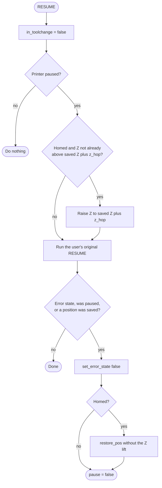

# `cmd_AFC_RESUME`

**Class:** `afcError`  
**File:** `extras/AFC_error.py`

Replaces the user's `RESUME` at startup. It runs the original resume and, after an error or pause, moves the toolhead back to the saved position.

## Flow

## Where it lives in code

| Step | Code |
| --- | --- |
| Command | `afcError.cmd_AFC_RESUME` in `extras/AFC_error.py` |
| Original resume | `AFC_RENAME_RESUME_NAME`, the user's `RESUME` renamed during PREP, run with `afc.run_script` |
| Z lift | [`afc.move_z_pos`](../AFC/move_z_pos.md) |
| Position | [`afc.restore_pos`](../AFC/restore_pos.md) with `move_z_first=False` |
| Error state | [`afcError.set_error_state`](set_error_state.md) |

## Notes

- This is not normally called by name. It exists so that clicking resume in a GUI also clears AFC's error state and restores the position.
- The lift happens first because the position was saved at print height, and the nozzle may be sitting low after a failed change.

## Related

- [`afc.restore_pos`](../AFC/restore_pos.md)
- [`afcError.reset_failure`](reset_failure.md)
- [`afcError.pause_print`](pause_print.md)
