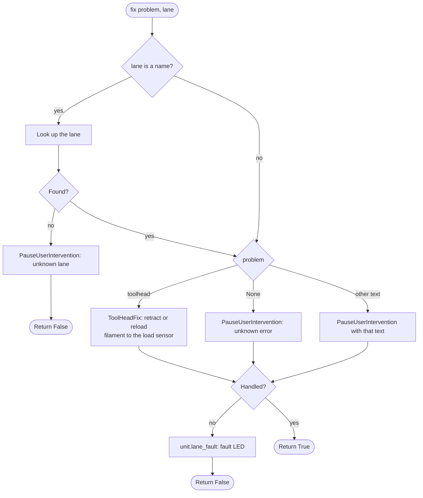

# `fix`

**Class:** `afcError`  
**File:** `extras/AFC_error.py`

Tries to repair a reported toolhead or lane problem on its own, and pauses for the user when it cannot.

## Flow

## Where it lives in code

| Step | Code |
| --- | --- |
| Method | `afcError.fix` in `extras/AFC_error.py` |
| Automatic repair | `afcError.ToolHeadFix`, which checks the sensors and retracts the lane back to its load sensor, up to 5 homing tries or 5000mm in short moves |
| Pausing | [`afcError.PauseUserIntervention`](PauseUserIntervention.md) |
| LED | `afcUnit.lane_fault` |
| Used by | [`afc.CHANGE_TOOL`](../AFC/CHANGE_TOOL.md) when an unload fails, and [`afc.TOOL_LOAD`](../AFC/TOOL_LOAD.md) when it cannot unload a stale lane |

## Notes

- Only the `toolhead` problem has an automatic fix. Everything else becomes a pause with the problem text as the message.

## Related

- [`afcError.PauseUserIntervention`](PauseUserIntervention.md)
- [`afcError.handle_lane_failure`](handle_lane_failure.md)
