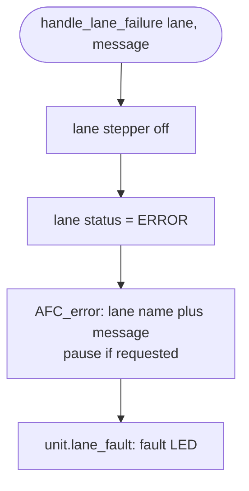

# `handle_lane_failure`

**Class:** `afcError`  
**File:** `extras/AFC_error.py`

Reports that a lane could not do what it was asked: stops its motor, marks it as errored and tells the user.

## Flow

## Where it lives in code

| Step | Code |
| --- | --- |
| Method | `afcError.handle_lane_failure` in `extras/AFC_error.py` |
| Motor | `AFCLane.do_enable(False)` |
| Status | `AFCLaneState.ERROR` in `extras/AFC.py` |
| Report | [`afcError.AFC_error`](AFC_error.md) |
| LED | `afcUnit.lane_fault` in `extras/AFC_unit.py` |
| Used by | [`afc.load_sequence`](../AFC/load_sequence.md), [`afc.unload_sequence`](../AFC/unload_sequence.md), [`afc.TOOL_LOAD`](../AFC/TOOL_LOAD.md) |

## Notes

- The messages include the exact commands to recover, such as `SET_LANE_LOADED`, `LANE_MOVE` and `AFC_RESET`, and name the next lane to load when a tool change was in progress.

## Related

- [`afcError.AFC_error`](AFC_error.md)
- [`afcError.cmd_AFC_RESUME`](cmd_AFC_RESUME.md)
