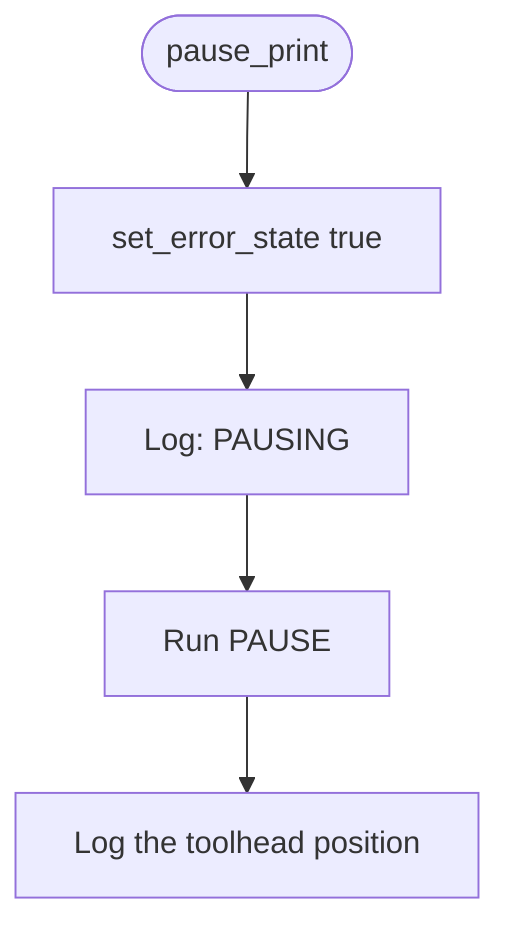

# `pause_print`

**Class:** `afcError`  
**File:** `extras/AFC_error.py`

Puts AFC into the error state and runs the user's `PAUSE` macro.

## Flow

## Where it lives in code

| Step | Code |
| --- | --- |
| Method | `afcError.pause_print` in `extras/AFC_error.py` |
| Error state | [`afcError.set_error_state`](set_error_state.md) |
| Pause | `PAUSE`, run with `afc.run_script`, which the user's macro or `pause_resume` provides |
| Position log | `afcFunction.log_toolhead_pos` |

## Notes

- `PAUSE` comes from the user's config. AFC replaces `RESUME` at startup with [`afcError.cmd_AFC_RESUME`](cmd_AFC_RESUME.md), so the matching resume restores the saved position.

## Related

- [`afcError.set_error_state`](set_error_state.md)
- [`afcError.cmd_AFC_RESUME`](cmd_AFC_RESUME.md)
