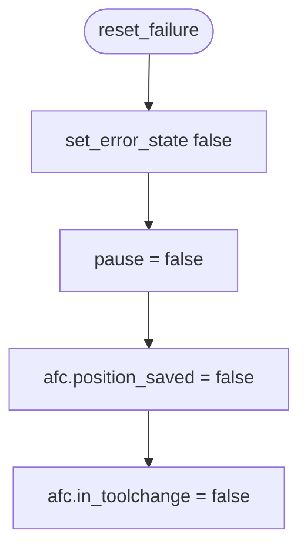

# `reset_failure`

**Class:** `afcError`  
**File:** `extras/AFC_error.py`

Clears the error bookkeeping: error state, the pause flag, the saved-position flag and the toolchange flag.

## Flow

## Where it lives in code

| Step | Code |
| --- | --- |
| Method | `afcError.reset_failure` in `extras/AFC_error.py` |
| Command | `afcError.cmd_RESET_FAILURE`, the `RESET_FAILURE` macro |
| Error state | [`afcError.set_error_state`](set_error_state.md) |

## Notes

- [`afcError.cmd_AFC_RESUME`](cmd_AFC_RESUME.md) does the same steps itself, plus the move back to the print.

## Related

- [`afcError.cmd_AFC_RESUME`](cmd_AFC_RESUME.md)
- [`afcError.set_error_state`](set_error_state.md)
