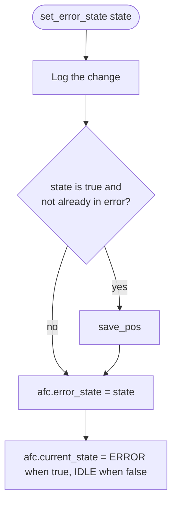

# `set_error_state`

**Class:** `afcError`  
**File:** `extras/AFC_error.py`

Turns the AFC error state on or off. The first time it turns on, it saves the toolhead position.

## Flow

## Where it lives in code

| Step | Code |
| --- | --- |
| Method | `afcError.set_error_state` in `extras/AFC_error.py` |
| Position | [`afc.save_pos`](../AFC/save_pos.md) |
| State | `afc.error_state` and `afc.current_state`, with `State.ERROR` and `State.IDLE` |

## Notes

- Because only the first call saves, a second error in the same incident cannot overwrite the position the print stopped at.

## Related

- [`afcError.pause_print`](pause_print.md)
- [`afcError.reset_failure`](reset_failure.md)
