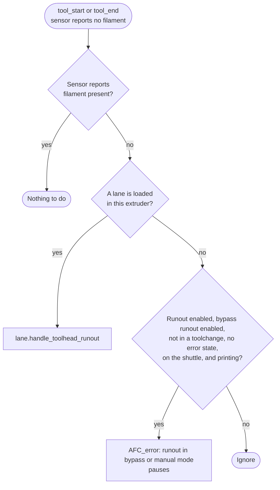

# `_handle_toolhead_sensor_runout`

**Class:** `AFCExtruder`  
**File:** `extras/AFC_extruder.py`

Entry point for a toolhead sensor reporting no filament. It passes the event to the loaded lane, or, with no lane loaded, optionally pauses a bypass print.

## Flow

## Where it lives in code

| Step | Code |
| --- | --- |
| Method | `AFCExtruder._handle_toolhead_sensor_runout` in `extras/AFC_extruder.py` |
| Callers | `AFCExtruder.handle_start_runout` and `handle_end_runout`, registered on the filament switches |
| Lane handler | [`AFCLane.handle_toolhead_runout`](../AFC_lane/handle_toolhead_runout.md) |
| Settings | `enable_tool_runout` and `enable_runout_in_bypass` |
| On shuttle | `AFCExtruder.on_shuttle` |
| Error | [`afcError.AFC_error`](../AFC_error/AFC_error.md) |

## Notes

- The bypass branch has five guards so it never pauses during a tool change, while an error is already being handled, or for a docked toolhead on a toolchanger.
- Both callbacks update `min_event_systime` afterwards, mimicking Klipper's runout helper, so later sensor changes are still detected.

## Related

- [`AFCLane.handle_toolhead_runout`](../AFC_lane/handle_toolhead_runout.md)
