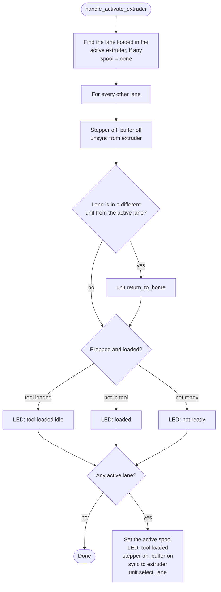

# `handle_activate_extruder`

**Class:** `afcFunction`  
**File:** `extras/AFC_functions.py`

Makes the lane in the active toolhead extruder the active lane, and switches the others off: motors, buffers, sync and LEDs.

## Flow

## Where it lives in code

| Step | Code |
| --- | --- |
| Method | `afcFunction.handle_activate_extruder` in `extras/AFC_functions.py` |
| Active lane | `afcFunction.get_current_lane_obj` and `get_current_extruder_obj` |
| Per lane | `AFCLane.do_enable`, `disable_buffer`, `enable_buffer`, `sync_to_extruder`, `unsync_to_extruder` |
| Units | `afcUnit.return_to_home`, `select_lane`, and the `lane_*` LED methods in `extras/AFC_unit.py` |
| Spool | `AFCSpool.set_active_spool` |
| Event wrapper | `afcFunction.handle_activate_extruder_cb`, runs this with `"sub_command"`, registered for `extruder:activate_extruder` |

## Notes

- It runs after every tool swap, after a manual `SET_LANE_LOADED`, after `AFC_UNSELECT_TOOL`, and when [`afc.CHANGE_TOOL`](../AFC/CHANGE_TOOL.md) is asked for the lane that is already current.
- The `eventtime` parameter is unused. It is a leftover from when this was a reactor timer callback.

## Related

- [`AfcToolchanger.tool_swap`](../AFC_Toolchanger/tool_swap.md)
- [`afcFunction.select_loaded_lane`](select_loaded_lane.md)
