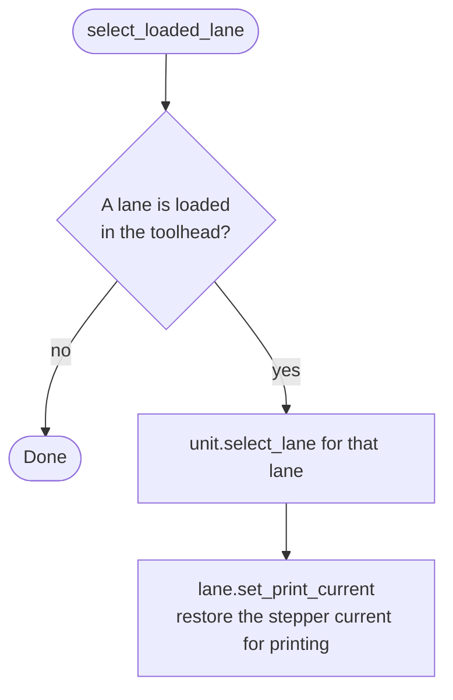

# `select_loaded_lane`

**Class:** `afcFunction`  
**File:** `extras/AFC_functions.py`

Re-selects the lane that is loaded in the toolhead, for units with a selector, after other lanes have been moved.

## Flow

## Where it lives in code

| Step | Code |
| --- | --- |
| Method | `afcFunction.select_loaded_lane` in `extras/AFC_functions.py` |
| Current lane | `afcFunction.get_current_lane_obj` |
| Selector | `afcUnit.select_lane` in `extras/AFC_unit.py` |
| Motor current | `AFCLane.set_print_current` |
| Used by | [`afc.LANE_UNLOAD`](../AFC/LANE_UNLOAD.md), after an eject |

## Notes

- An eject moves the selector to the ejected lane. This puts it back so the printing lane still feeds.

## Related

- [`afc.LANE_UNLOAD`](../AFC/LANE_UNLOAD.md)
