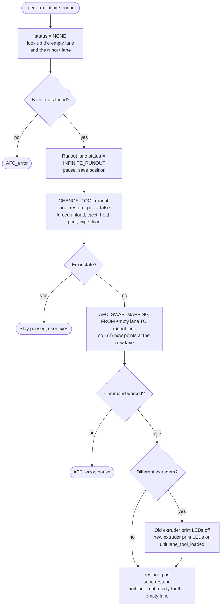

# `_perform_infinite_runout`

**Class:** `AFCLane`  
**File:** `extras/AFC_lane.py`

Swaps to the runout lane without stopping the print: unload the empty lane, load the next one, swap their T(n) mappings, and resume.

## Flow

## Where it lives in code

| Step | Code |
| --- | --- |
| Method | `AFCLane._perform_infinite_runout` in `extras/AFC_lane.py` |
| Pause and position | `afc.error.pause_resume.send_pause_command`, [`afc.save_pos`](../AFC/save_pos.md) |
| Tool change | [`afc.CHANGE_TOOL`](../AFC/CHANGE_TOOL.md) with `restore_pos=False` |
| Mapping swap | `AFC_SWAP_MAPPING` command, run with `afc.run_script` |
| LEDs | `AFCExtruder.set_print_leds`, `afcUnit.lane_tool_loaded`, `afcUnit.lane_not_ready` |
| Restore | [`afc.restore_pos`](../AFC/restore_pos.md), `afc.error.pause_resume.send_resume_command` |
| Errors | [`afcError.AFC_error`](../AFC_error/AFC_error.md) |

## Notes

- Four things start it: [`AFCLane.handle_toolhead_runout`](handle_toolhead_runout.md) for standalone toolheads, `AFCLane.handle_prep_runout` when the prep sensor drops during a print, [`AFCLane.handle_load_runout`](handle_load_runout.md) for units that use their own runout rules, and `AFCLane._handle_auto_spool_switch` when a weight threshold is reached.
- The position is restored only after the new lane has loaded, so the nozzle does not sit on the print while the old lane unloads.
- Without a `runout_lane` the same triggers go to [`AFCLane._perform_pause_runout`](_perform_pause_runout.md) instead.

## Related

- [`afc.CHANGE_TOOL`](../AFC/CHANGE_TOOL.md)
- [`AFCLane.handle_toolhead_runout`](handle_toolhead_runout.md)
- [`AFCLane._perform_pause_runout`](_perform_pause_runout.md)
