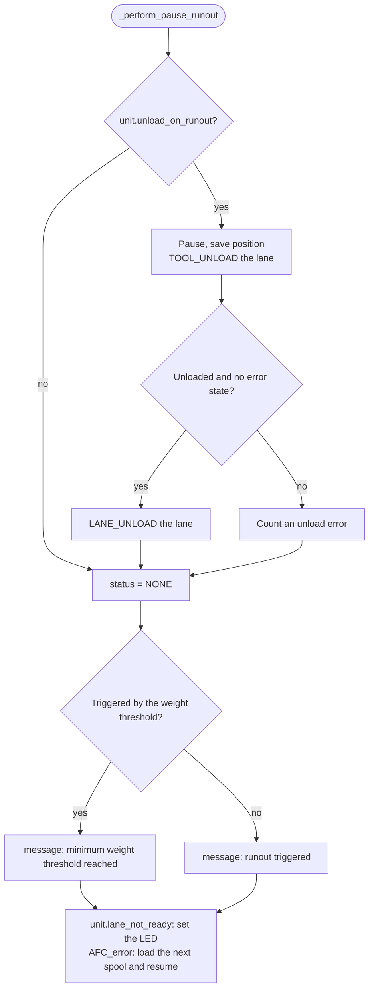

# `_perform_pause_runout`

**Class:** `AFCLane`  
**File:** `extras/AFC_lane.py`

Pauses the print when a lane runs out and no replacement lane is set up. Optionally unloads and ejects the empty lane first.

## Flow

## Where it lives in code

| Step | Code |
| --- | --- |
| Method | `AFCLane._perform_pause_runout` in `extras/AFC_lane.py` |
| Setting | `unload_on_runout` on the unit |
| Pause | `afc.error.pause_resume.send_pause_command` and [`afc.save_pos`](../AFC/save_pos.md) |
| Unload and eject | [`afc.TOOL_UNLOAD`](../AFC/TOOL_UNLOAD.md), [`afc.LANE_UNLOAD`](../AFC/LANE_UNLOAD.md) |
| Stats | `afc.afc_stats.increase_unload_error_count` |
| Message | [`afcError.AFC_error`](../AFC_error/AFC_error.md), which pauses |
| Weight trigger | `AFCLane.auto_switch_triggered`, set by the weight timer |

## Notes

- The user loads the next spool by hand and resumes. [`afcError.cmd_AFC_RESUME`](../AFC_error/cmd_AFC_RESUME.md) restores the saved position.

## Related

- [`AFCLane._perform_infinite_runout`](_perform_infinite_runout.md)
- [`AFCLane.handle_toolhead_runout`](handle_toolhead_runout.md)
