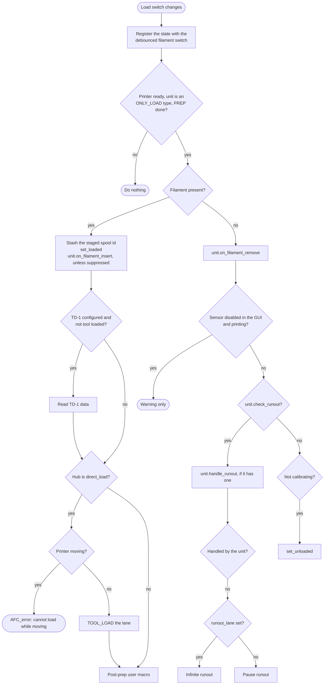

# `handle_load_runout`

**Class:** `AFCLane`  
**File:** `extras/AFC_lane.py`

Handles the load switch for units that only have a load sensor. A rising edge is a spool being inserted, a falling edge is a removal or a runout.

## Flow

## Where it lives in code

| Step | Code |
| --- | --- |
| Callback | `AFCLane.handle_load_runout` in `extras/AFC_lane.py` |
| Insert | [`AFCLane.set_loaded`](set_loaded.md), `afcUnit.on_filament_insert` in `extras/AFC_unit.py` |
| Direct load | [`afc.TOOL_LOAD`](../AFC/TOOL_LOAD.md) |
| Remove | `afcUnit.on_filament_remove` |
| Unit runout rules | `afcUnit.check_runout` and the unit's optional `handle_runout` |
| Runout | [`AFCLane._perform_infinite_runout`](_perform_infinite_runout.md), [`AFCLane._perform_pause_runout`](_perform_pause_runout.md) |
| Removal | [`AFCLane.set_unloaded`](set_unloaded.md) |

## Notes

- `_load_suppressed` marks a state change AFC caused itself, such as an eject, so that it does not look like a user inserting a spool.
- This method exists separately from [`AFCLane.load_callback`](load_callback.md) because it is called by the filament switch's runout helper, and the helper can delay it.

## Related

- [`AFCLane.load_callback`](load_callback.md)
- [`AFCLane._perform_infinite_runout`](_perform_infinite_runout.md)
