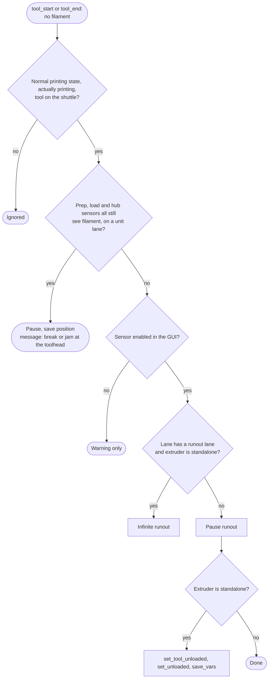

# `handle_toolhead_runout`

**Class:** `AFCLane`  
**File:** `extras/AFC_lane.py`

Decides what a toolhead sensor reporting no filament means: a jam, an infinite spool changeover, or a pause for a new spool.

## Flow

## Where it lives in code

| Step | Code |
| --- | --- |
| Method | `AFCLane.handle_toolhead_runout` in `extras/AFC_lane.py` |
| Printing state | `AFCLane._is_normal_printing_state` and `afcFunction.is_printing` |
| On shuttle | `AFCExtruder.on_shuttle` in `extras/AFC_extruder.py` |
| Upstream sensors | `AFCLane.prep_state`, `AFCLane.raw_load_state`, `afc_hub.state` |
| Jam | `afc.error.pause_resume.send_pause_command`, [`afc.save_pos`](../AFC/save_pos.md), [`afcError.AFC_error`](../AFC_error/AFC_error.md) |
| Runout | [`AFCLane._perform_infinite_runout`](_perform_infinite_runout.md), [`AFCLane._perform_pause_runout`](_perform_pause_runout.md) |
| Standalone cleanup | [`AFCLane.set_tool_unloaded`](set_tool_unloaded.md), [`AFCLane.set_unloaded`](set_unloaded.md) |
| Caller | [`AFCExtruder._handle_toolhead_sensor_runout`](../AFC_extruder/_handle_toolhead_sensor_runout.md) |

## Notes

- The first split is the useful one: if everything upstream still sees filament, the filament is stuck, not finished.
- Infinite spool at the toolhead sensor is only automatic for standalone toolheads. A TODO in the code notes that a general version is tracked in a GitHub issue. Unit lanes reach infinite runout earlier, from the prep or load sensor, see [`AFCLane._perform_infinite_runout`](_perform_infinite_runout.md).

## Related

- [`AFCExtruder._handle_toolhead_sensor_runout`](../AFC_extruder/_handle_toolhead_sensor_runout.md)
- [`AFCLane._perform_infinite_runout`](_perform_infinite_runout.md)
- [`AFCLane._perform_pause_runout`](_perform_pause_runout.md)
