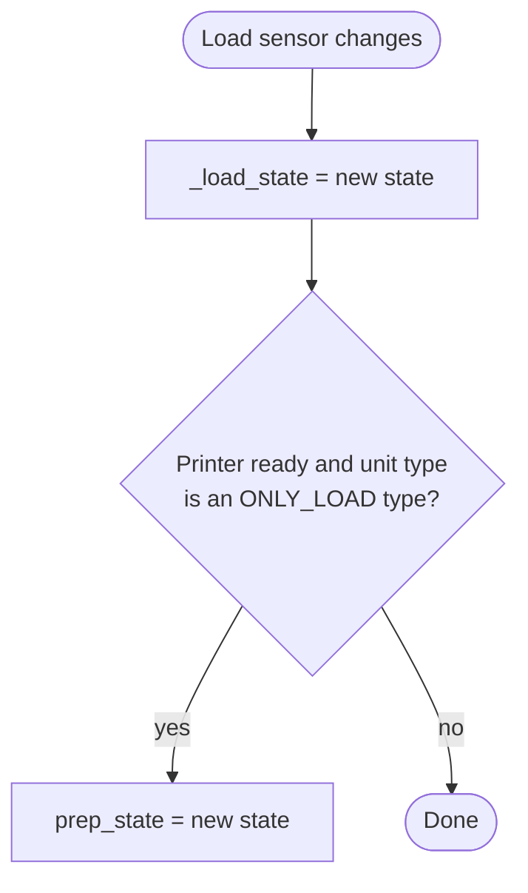

# `load_callback`

**Class:** `AFCLane`  
**File:** `extras/AFC_lane.py`

Runs when the load sensor changes. For units that only have a load switch it also acts as the prep state.

## Flow

## Where it lives in code

| Step | Code |
| --- | --- |
| Callback | `AFCLane.load_callback` in `extras/AFC_lane.py` |
| Unit types | `ONLY_LOAD_TYPES` in `extras/AFC_lane.py` |
| Debounced variant | [`AFCLane.handle_load_runout`](handle_load_runout.md), used when the load switch is a debounced filament switch |

## Notes

- Units with both a prep and a load sensor ignore the second step, because [`AFCLane.prep_callback`](prep_callback.md) owns `prep_state` for them.

## Related

- [`AFCLane.handle_load_runout`](handle_load_runout.md)
- [`AFCLane.prep_callback`](prep_callback.md)
