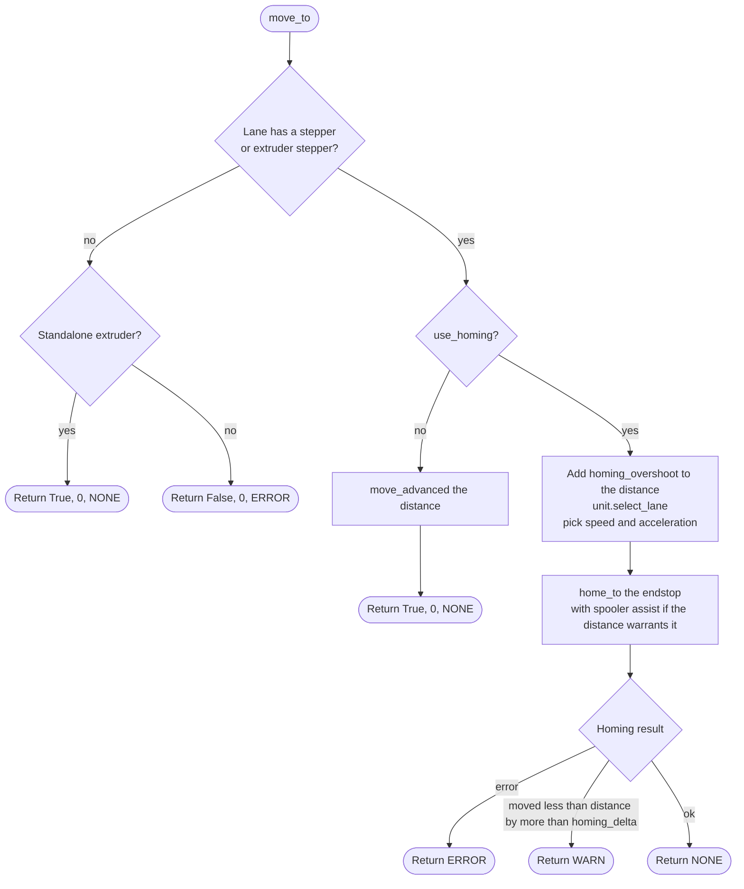

# `move_to`

**Class:** `AFCLane`  
**File:** `extras/AFC_lane.py`

Moves a lane's stepper, either as a homing move that stops at a sensor or as a plain move. It also reports whether the move came up short.

## Flow

## Where it lives in code

| Step | Code |
| --- | --- |
| Method | `AFCLane.move_to` in `extras/AFC_lane.py` |
| Plain move | `AFCLane.move_advanced` |
| Homing | `AFCExtruderStepper.home_to` in `extras/AFC_stepper.py`, called on the lane's drive stepper, or on the lane itself when it has none. Lanes are `AFCExtruderStepper` objects, a subclass of `AFCLane` |
| Selecting the lane | `afcUnit.select_lane` in `extras/AFC_unit.py` |
| Speeds | `AFCLane.get_speed_accel` with a `SpeedMode` |
| Assist | `AFCLane.get_active_assist` |
| Overshoot and delta | `homing_overshoot` and `homing_delta` on the unit |
| Wrappers | [`afcUnit.move_to_hub`](../AFC_unit/move_to_hub.md) and [`afcUnit.load_then_home`](../AFC_unit/load_then_home.md) |

## Notes

- Everything in the load and unload sequences that stops at a sensor goes through here, and the three results tell the caller what to do: `NONE` carries on, `WARN` retries, `ERROR` aborts.
- With homing disabled the method returns `True, 0, NONE` after a plain move, so callers cannot tell how far it went. That is why the sequences also check sensors afterwards.

## Related

- [`afcUnit.move_to_hub`](../AFC_unit/move_to_hub.md)
- [`afcUnit.load_then_home`](../AFC_unit/load_then_home.md)
