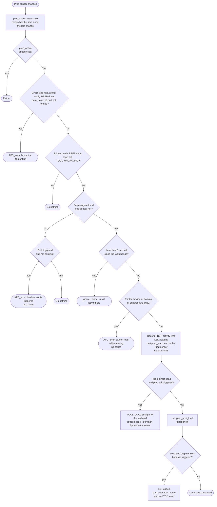

# `prep_callback`

**Class:** `AFCLane`  
**File:** `extras/AFC_lane.py`

Runs when the prep (filament present) sensor changes. A spool pushed in is fed to the load sensor and, for most units, on to the hub.

## Flow

## Where it lives in code

| Step | Code |
| --- | --- |
| Callback | `AFCLane.prep_callback` in `extras/AFC_lane.py`, registered on the lane's prep button |
| Re-entrancy guard | `AFCLane.prep_active`, cleared in a `finally` block |
| Mutex | `AFCLane.mutex`, so two sensor events cannot interleave |
| Busy check | `afcFunction.is_printing(check_movement=True)` and `AFCLane.prep_active` on other lanes |
| Feed to the load sensor | `afcUnit.prep_load`, BoxTurtle: [`afcBoxTurtle.prep_load`](../AFC_BoxTurtle/prep_load.md) |
| Feed to the hub | `afcUnit.prep_post_load`, BoxTurtle: [`afcBoxTurtle.prep_post_load`](../AFC_BoxTurtle/prep_post_load.md) |
| Direct load | [`afc.TOOL_LOAD`](../AFC/TOOL_LOAD.md) and `AFCSpool._set_values` in `extras/AFC_spool.py` |
| Lane state | [`AFCLane.set_loaded`](set_loaded.md) |
| LEDs | `afcUnit.lane_loading` in `extras/AFC_unit.py` |
| Post macro and TD-1 | `AFCLane._post_prep_user_macro` and `_prep_capture_td1` |
| Errors | [`afcError.AFC_error`](../AFC_error/AFC_error.md) |

## Notes

- The one second check exists because Klipper takes a moment to transition out of idle, and the sensor can fire twice for one insertion.
- A prep sensor that goes low is a removal or runout and is handled by `AFCLane.handle_prep_runout`, a separate callback registered on the filament switch. It is not drawn here.
- Every `gcmd` in this method is the literal `"callback"`, because it runs from a hardware sensor event with no gcode command in flight.
- `afc.save_vars` runs once at the end, after the `finally` block, and only on normal completion.

## Related

- [`AFCLane.load_callback`](load_callback.md)
- [`AFCLane.set_loaded`](set_loaded.md)
- [`afcBoxTurtle.prep_load`](../AFC_BoxTurtle/prep_load.md)
- [`afc.TOOL_LOAD`](../AFC/TOOL_LOAD.md)
