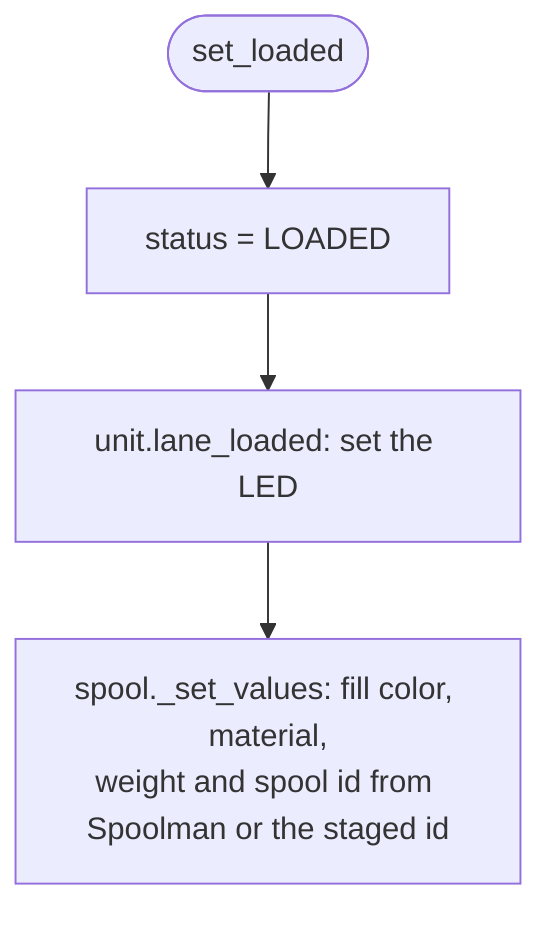

# `set_loaded`

**Class:** `AFCLane`  
**File:** `extras/AFC_lane.py`

Marks a lane as loaded into the unit, with filament at the load sensor but not in the toolhead.

## Flow

## Where it lives in code

| Step | Code |
| --- | --- |
| Method | `AFCLane.set_loaded` in `extras/AFC_lane.py` |
| LED | `afcUnit.lane_loaded` in `extras/AFC_unit.py` |
| Spool values | `AFCSpool._set_values` in `extras/AFC_spool.py` |

## Notes

- Counterpart of [`AFCLane.set_unloaded`](set_unloaded.md). [`AFCLane.set_tool_loaded`](set_tool_loaded.md) covers the next stage, filament in the toolhead.

## Related

- [`AFCLane.set_unloaded`](set_unloaded.md)
- [`AFCLane.set_tool_loaded`](set_tool_loaded.md)
