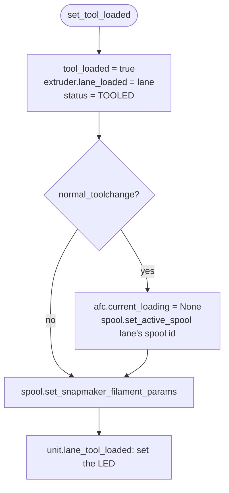

# `set_tool_loaded`

**Class:** `AFCLane`  
**File:** `extras/AFC_lane.py`

Marks a lane as loaded into the toolhead and makes it the extruder's lane.

## Flow

## Where it lives in code

| Step | Code |
| --- | --- |
| Method | `AFCLane.set_tool_loaded` in `extras/AFC_lane.py` |
| Extruder link | `AFCExtruder.lane_loaded` in `extras/AFC_extruder.py` |
| Active spool | `AFCSpool.set_active_spool` in `extras/AFC_spool.py`, reports to Spoolman |
| Snapmaker data | `AFCSpool.set_snapmaker_filament_params`, does nothing on other printers |
| LED | `afcUnit.lane_tool_loaded` in `extras/AFC_unit.py` |
| Called from | [`afc.load_sequence`](../AFC/load_sequence.md) at its end, and the manual `SET_LANE_LOADED` command, `AFCLane.cmd_SET_LANE_LOADED` |

## Notes

- `normal_toolchange=True` is passed from the load and unload sequences and from `SET_LANE_LOADED`. Other callers, such as a standalone toolhead restoring its state at startup, leave it `False` and so do not touch `current_loading` or the active spool.

## Related

- [`AFCLane.set_tool_unloaded`](set_tool_unloaded.md)
- [`afc.load_sequence`](../AFC/load_sequence.md)
